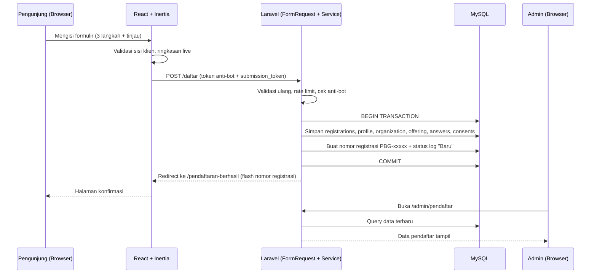
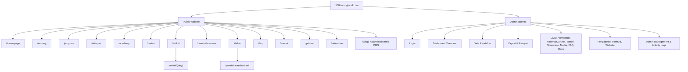
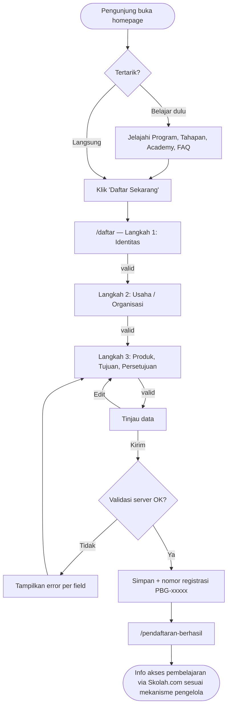
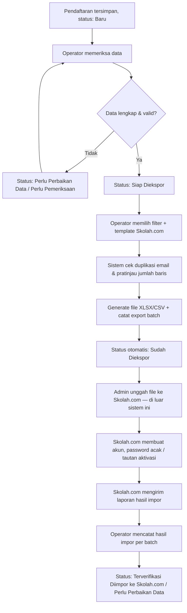
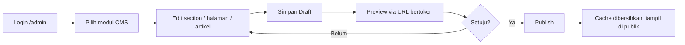
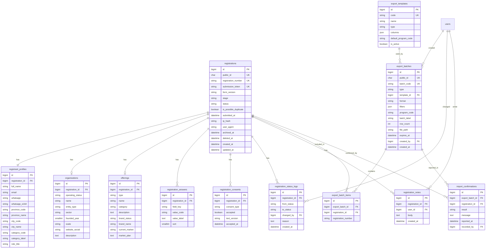
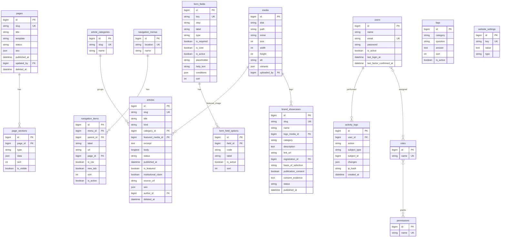

# PRD — Website 500 Brand Global (www.500brandglobal.com)

| | |
|---|---|
| **Versi dokumen** | 1.0 (Draft untuk review) |
| **Tanggal** | 11 Oktober 2026 |
| **Pemilik produk** | ARRBEY Branding & Sekolah Ekspor Nasional |
| **Sumber** | Master Brief Pengembangan Website 500 Brand Global; referensi homepage (`500brandglobal_preview_standalone_1.html`); referensi formulir (`formulir_tahap1.html`); format contoh PRD |
| **Target pembaca** | Developer / Claude Code sebagai dasar implementasi, serta pemilik program untuk persetujuan |

> **Cara membaca dokumen ini.** Master Brief adalah sumber kebenaran utama. Dua file HTML referensi adalah sumber kebenaran untuk **gaya visual** dan **pola interaksi formulir**. Bila isi HTML referensi berbeda dari Master Brief, PRD ini mengikuti Master Brief dan mencatat selisihnya di **Bagian 21** supaya bisa diputuskan, bukan diam-diam dipilih.

---

## Daftar Isi

1. [Project Overview](#1-project-overview)
2. [Business Goals & Success Metrics](#2-business-goals--success-metrics)
3. [Product Scope](#3-product-scope)
4. [Keputusan Arsitektur & Technology Stack](#4-keputusan-arsitektur--technology-stack)
5. [Sitemap & Information Architecture](#5-sitemap--information-architecture)
6. [User Roles & Permissions](#6-user-roles--permissions)
7. [User Flows](#7-user-flows)
8. [Spesifikasi Homepage](#8-spesifikasi-homepage)
9. [Spesifikasi Halaman Publik Lainnya](#9-spesifikasi-halaman-publik-lainnya)
10. [Formulir Pendaftaran Tahap 1](#10-formulir-pendaftaran-tahap-1)
11. [Admin Dashboard & Monitoring Pendaftaran](#11-admin-dashboard--monitoring-pendaftaran)
12. [Export Excel/CSV & Proses Impor Skolah.com](#12-export-excelcsv--proses-impor-skolahcom)
13. [CMS Requirements](#13-cms-requirements)
14. [Database Schema & ERD](#14-database-schema--erd)
15. [Functional Requirements](#15-functional-requirements)
16. [Non-Functional Requirements](#16-non-functional-requirements)
17. [UI/UX Guidelines](#17-uiux-guidelines)
18. [Security & Privacy Requirements](#18-security--privacy-requirements)
19. [Acceptance Criteria](#19-acceptance-criteria)
20. [Implementation Roadmap, Testing & Deployment](#20-implementation-roadmap-testing--deployment)
21. [Asumsi, Selisih Referensi, dan Pertanyaan Konfirmasi](#21-asumsi-selisih-referensi-dan-pertanyaan-konfirmasi)
22. [Lampiran](#22-lampiran)

---

## 1. Project Overview

### 1.1 Latar belakang

Gerakan **Brand Nasional Go Global** dan flagship-nya, **Program Nasional 500 Brand Go Global (2026–2029)**, memerlukan satu portal resmi penyelenggara untuk: (1) menjelaskan program kepada publik, (2) menerima pendaftaran peminat Tahap 1, (3) mengelola data pendaftar, dan (4) menjadi titik awal alur ke platform pembelajaran Skolah.com.

Saat ini belum ada sistem. Homepage dan formulir baru ada sebagai prototipe HTML statis yang tidak menyimpan data (formulir hanya menyalin JSON atau membuka WhatsApp). Hasil akhir yang dikehendaki adalah **website production-ready**, bukan mockup.

### 1.2 Identitas program

| Item | Nilai |
|---|---|
| Nama gerakan | Brand Nasional Go Global |
| Flagship program | Program Nasional 500 Brand Go Global |
| Periode | 2026–2029 |
| Tagline | *Keep the Identity. Build Global Relevance. Go Global.* |
| Inisiator | ARRBEY Branding dan Sekolah Ekspor Nasional |
| Target program | Fasilitasi transformasi 500 brand terpilih dari Indonesia menuju relevansi global |
| Email utama | 500brandglobal@gmail.com |
| Sasaran peminat | UMKM, perusahaan, startup, koperasi, organisasi, asosiasi, komunitas, perguruan tinggi, pemerintah daerah, calon wirausaha |
| Jenis brand | Produk fisik, jasa, karya kreatif, musik, fashion, desain, destinasi, institusi pendidikan, organisasi, brand daerah |

### 1.3 Masalah yang diselesaikan

1. Belum ada kanal resmi yang menjelaskan program secara kredibel dan konsisten.
2. Pendaftaran peminat belum terstruktur, tidak tersimpan, dan tidak bisa dipantau atau diekspor.
3. Konten website harus bisa diubah admin non-teknis tanpa menyentuh source code.
4. Data peserta perlu berpindah ke Skolah.com (LMS) dengan cara yang aman, terlacak, dan bebas duplikasi.

### 1.4 Prinsip produk (tidak boleh dilanggar)

| # | Prinsip | Konsekuensi |
|---|---|---|
| P1 | **Pendaftar ≠ terpilih.** Mengisi formulir tidak otomatis menjadikan seseorang salah satu dari 500 brand. | Semua copy, status, dan UI tidak boleh menyiratkan seleksi, pendampingan, atau manfaat otomatis. |
| P2 | **500 adalah target, bukan capaian.** | Angka 500 selalu diberi label "target/sasaran". |
| P3 | **Penetapan kandidat dilakukan instansi berwenang**, bukan website. | Website tidak memiliki fitur "menetapkan/meluluskan kandidat". |
| P4 | **Klaim kelembagaan harus berdasar dokumen resmi.** Dukungan, logo, atau status resmi Kementerian Perdagangan RI hanya dicantumkan bila ada persetujuan/dokumen resmi. | Konten terkait Kemendag wajib melalui checklist verifikasi (Bagian 13.7). |
| P5 | **Dua sistem terpisah.** 500brandglobal.com tidak membuat akun, password, LMS, ujian, atau sertifikasi peserta. | Tidak ada login peserta. Integrasi MVP = ekspor/impor file. |
| P6 | **Privasi sebagai syarat utama.** | Tidak ada data pribadi pendaftar di halaman publik. Ada persetujuan eksplisit, audit log, dan kebijakan retensi. |

---

## 2. Business Goals & Success Metrics

### 2.1 Tujuan bisnis

| ID | Tujuan | Cara website mendukung |
|---|---|---|
| G1 | **Media informasi program** | Halaman program, tahapan, academy, materi, artikel/berita, FAQ, kontak. |
| G2 | **Portal pendaftaran Tahap 1** | Formulir publik tanpa login, tersimpan di MySQL, ada nomor registrasi. |
| G3 | **Sistem pengelolaan pendaftar** | Dashboard admin: pantau, cari, filter, periksa, ubah status, ekspor. |
| G4 | **CMS dinamis** | Admin mengelola halaman, section, banner, artikel, menu, FAQ, dan pengaturan formulir. |

### 2.2 Metrik keberhasilan (usulan, perlu persetujuan target angka)

| Metrik | Cara ukur | Target awal (usulan) |
|---|---|---|
| Konversi kunjungan → submit formulir | Analytics + data registrasi | Dipantau sejak launch; target ditetapkan setelah 4 minggu baseline |
| Tingkat penyelesaian formulir | Dimulai vs terkirim (event analytics) | ≥ 60% dari yang mencapai langkah 2 |
| Data duplikat/invalid per batch ekspor | Laporan batch | < 3% |
| Waktu admin menyiapkan satu batch ekspor | Observasi operasional | < 10 menit untuk 500 baris |
| Perubahan konten tanpa developer | Jumlah update CMS vs permintaan developer | 100% perubahan konten harian via CMS |
| Skor kinerja halaman publik (mobile) | Lighthouse / CrUX | Performance ≥ 85, Accessibility ≥ 95, SEO ≥ 95 |

---

## 3. Product Scope

### 3.1 In scope

**Public website**: 15 halaman (Bagian 5), termasuk homepage 15 section, formulir Tahap 1, konfirmasi, FAQ, kontak, dan halaman legal.

**Admin dashboard (`/admin`)**: overview statistik, manajemen pendaftar, ekspor, riwayat ekspor/impor, CMS (homepage, halaman, artikel, materi, showcase, media, FAQ, menu, pengaturan formulir, pengaturan website), manajemen admin, activity log.

**Integrasi Skolah.com (MVP)**: berbasis **ekspor XLSX/CSV** oleh admin dan **pencatatan hasil impor** secara manual.

### 3.2 Out of scope (tegas)

| Tidak dibuat | Alasan |
|---|---|
| Login/dashboard/akun/password peserta | Dikelola Skolah.com (P5) |
| LMS, ujian kompetensi, sertifikasi | Dikelola Skolah.com |
| Fitur seleksi/penetapan kandidat 500 brand | Wewenang instansi berwenang (P3) |
| Integrasi API otomatis ke Skolah.com | Phase 3, bila diperlukan |
| Pembayaran online | Tidak ada di brief |
| Aplikasi mobile native | Tidak ada di brief |
| Multi-bahasa (EN) | Tidak ada di brief; struktur dibuat i18n-ready (lihat 21.2) |

### 3.3 Pembagian fase (ringkas; detail di Bagian 20)

| Fase | Isi |
|---|---|
| **Phase 1 — MVP** | Setup stack, desain homepage, halaman publik, formulir Tahap 1, MySQL, konfirmasi, auth admin, dashboard, manajemen pendaftar, ekspor XLSX/CSV, CMS halaman & homepage, pengaturan kontak/menu/SEO |
| **Phase 2 — Penguatan operasional** | Advanced filtering, riwayat ekspor, pencatatan hasil impor Skolah.com, notifikasi email operasional, media library lengkap, audit & monitoring, peningkatan CMS, backup & pelaporan |
| **Phase 3 — Lanjutan** | API resmi Skolah.com, sinkronisasi status akun, analytics program, dashboard laporan lanjutan |

---

## 4. Keputusan Arsitektur & Technology Stack

### 4.1 Keputusan arsitektur yang dipertahankan

```
500brandglobal.com = Website Publik + Formulir Pendaftaran + CMS Admin + Monitoring + Export Excel
Skolah.com         = Akun Peserta + Password + LMS + Pembelajaran + Kompetensi
```

Kedua sistem terpisah. Pada tahap awal dihubungkan **hanya** melalui ekspor dan impor data peserta.

### 4.2 Stack

| Lapisan | Pilihan | Catatan |
|---|---|---|
| Backend | **Laravel** (versi stabil terbaru yang kompatibel saat setup; PHP 8.3+) | Satu aplikasi monolit untuk publik + admin |
| Frontend | **React + TypeScript** | |
| Integrasi | **Inertia.js** | Tanpa API terpisah. Jangan memisah frontend/backend tanpa alasan teknis jelas |
| UI | **shadcn/ui** + **Tailwind CSS** + **Lucide Icons** | |
| Database | **MySQL 8** | utf8mb4, InnoDB |
| Auth | Laravel Authentication (khusus admin) | Disarankan memakai Laravel React starter kit (Inertia + TS + shadcn/ui) sebagai pondasi |
| Storage | Laravel Storage | Disk `public` untuk media publik; disk `private` untuk file ekspor |
| Excel/CSV | **Laravel Excel** (`maatwebsite/excel`) | |
| Rich text | **TipTap** (atau setara) | Output disanitasi di server |
| Role & permission | `spatie/laravel-permission` | |
| Audit log | `spatie/laravel-activitylog` (atau implementasi sendiri) | |
| Anti-bot | Cloudflare Turnstile (atau reCAPTCHA) + honeypot + rate limit | Pilihan final di 21.3 |
| SEO | `spatie/laravel-sitemap`, meta via komponen `<Head>` Inertia | |
| SSR | **Inertia SSR** untuk halaman publik | Membutuhkan Node di server produksi |
| Testing | Pest/PHPUnit, Vitest + Testing Library, Playwright, axe-core | |

> Paket di atas adalah rekomendasi; boleh diganti setara selama kebutuhan fungsional dan keamanan terpenuhi. Struktur kode harus modular, maintainable, dan mengikuti konvensi Laravel serta React.

### 4.3 Struktur aplikasi (usulan)

```
app/
  Domain/            # logika bisnis per modul (tanpa campur controller)
    Registration/    # RegisterApplicant, GenerateRegistrationNumber, StatusTransition
    Export/          # BuildFullExport, BuildSkolahExport, SanitizeCell
    Cms/             # PageService, SectionRegistry, MediaService
  Http/Controllers/
    Public/          # HomeController, PageController, ArticleController, RegistrationController
    Admin/           # DashboardController, RegistrantController, ExportController, Cms/*
  Http/Requests/     # FormRequest validasi (sumber kebenaran validasi)
  Models/  Policies/  Jobs/  Exports/
resources/js/
  pages/public/  pages/admin/
  components/ui/            # shadcn/ui
  components/sections/      # satu komponen per tipe section CMS
  components/registration/  # wizard, ringkasan live
  lib/  hooks/  types/
database/migrations  seeders  factories
tests/Feature  tests/Unit  tests/e2e
```

### 4.4 Alur data pendaftaran (arsitektur teknis)



---

## 5. Sitemap & Information Architecture

### 5.1 Sitemap



### 5.2 Tabel route publik

| # | Halaman | Route | Tipe | Sumber konten | Diindeks |
|---|---|---|---|---|---|
| 1 | Homepage | `/` | Khusus (block-based) | CMS Homepage | Ya |
| 2 | Tentang Program | `/tentang` | Halaman dinamis | CMS Halaman | Ya |
| 3 | Program 500 Brand Go Global | `/program` | Halaman dinamis | CMS Halaman | Ya |
| 4 | Tahapan Program | `/tahapan` | Halaman dinamis | CMS Halaman | Ya |
| 5 | Global Brand Academy | `/academy` | Halaman dinamis | CMS Halaman | Ya |
| 6 | Materi dan Wawasan | `/materi` (alias `/wawasan` → 301) | Daftar + detail | Tabel `articles` (tipe `materi`) | Ya |
| 7 | Artikel dan Berita | `/artikel` | Daftar | Tabel `articles` (tipe `artikel`/`berita`) | Ya |
| 8 | Detail Artikel | `/artikel/{slug}` | Detail | `articles` | Ya |
| 9 | Brand Showcase | `/brand-showcase` | Daftar | `brand_showcases` | Ya |
| 10 | Formulir Tahap 1 | `/daftar` | Khusus (wizard) | Konfigurasi `form_fields` | Ya |
| 11 | Konfirmasi | `/pendaftaran-berhasil` | Khusus | Flash session | **Tidak** (`noindex`) |
| 12 | FAQ | `/faq` | Khusus | `faqs` | Ya |
| 13 | Kontak | `/kontak` | Halaman dinamis + settings | CMS + `website_settings` | Ya |
| 14 | Kebijakan Privasi | `/privasi` | Halaman dinamis | CMS Halaman | Ya |
| 15 | Syarat dan Ketentuan | `/ketentuan` | Halaman dinamis | CMS Halaman | Ya |
| — | Halaman baru buatan admin | `/{slug}` | Halaman dinamis | CMS Halaman | Sesuai pengaturan |

**Aturan slug**: slug sistem (daftar, admin, artikel, dst.) dicadangkan dan tidak boleh dipakai halaman dinamis. Perubahan slug membuat redirect 301 otomatis dari slug lama.

---

## 6. User Roles & Permissions

### 6.1 Peran

| Peran | Login | Deskripsi |
|---|---|---|
| **Public Visitor** | Tidak | Membaca halaman publik, mengisi dan mengirim formulir, melihat konfirmasi. Tidak ada akun/dashboard. |
| **Super Admin** | Ya | Akses penuh termasuk manajemen admin, pengaturan, dan log. |
| **Content Editor** | Ya | Mengelola konten CMS. Tidak melihat data pribadi pendaftar. |
| **Registration Operator** | Ya | Memeriksa pendaftar, ubah status, ekspor, catat impor. Tidak mengubah konten/pengaturan. |

> Brief menyebut dua jenis akses utama dan tiga sub-peran "bila diperlukan". PRD ini mengimplementasikan ketiganya di MVP karena biaya tambahannya kecil dan memenuhi prinsip *least privilege* untuk data pribadi (lihat 21.3 K15 bila ingin menyederhanakan).

### 6.2 Matriks izin

| Modul | Super Admin | Content Editor | Registration Operator |
|---|:-:|:-:|:-:|
| Dashboard overview (statistik agregat) | ✔ | ✔ (tanpa tabel pendaftar terbaru) | ✔ |
| Data pendaftar: lihat daftar & detail | ✔ | ✘ | ✔ |
| Ubah status / catatan internal / arsipkan | ✔ | ✘ | ✔ |
| Hapus permanen (purge) data pendaftar | ✔ (dengan konfirmasi & alasan) | ✘ | ✘ |
| Ekspor data lengkap | ✔ | ✘ | ✔ |
| Ekspor Skolah.com & catat hasil impor | ✔ | ✘ | ✔ |
| CMS Homepage / Halaman / Artikel / Materi / FAQ / Menu | ✔ | ✔ | ✘ |
| Publikasi konten (draft → published) | ✔ | ✔ | ✘ |
| Brand Showcase | ✔ | ✔ (publikasi butuh checklist persetujuan) | ✘ |
| Media Library | ✔ | ✔ | ✘ (lihat saja) |
| Pengaturan Formulir | ✔ | ✘ | ✘ |
| Website Settings | ✔ | ✘ | ✘ |
| Admin Management | ✔ | ✘ | ✘ |
| Activity Logs | ✔ | ✘ | ✘ (log milik sendiri) |

Seluruh pemeriksaan izin dilakukan di server melalui Policy/Gate, bukan hanya menyembunyikan menu.

---

## 7. User Flows

### 7.1 Flow pengunjung → pendaftaran



### 7.2 Flow operasional admin ↔ Skolah.com



**Aturan penting**: "Sudah Diekspor" **tidak pernah** otomatis berarti berhasil diimpor. Status "Terverifikasi Diimpor ke Skolah.com" hanya bisa diset lewat pencatatan hasil impor.

### 7.3 Flow admin mengelola konten



---

## 8. Spesifikasi Homepage

### 8.1 Aturan umum

- Urutan section **mengikuti Master Brief (15 section)** dan tidak boleh diubah tanpa persetujuan. Admin dapat menyembunyikan/menampilkan section, tetapi mengubah urutan section homepage hanya oleh Super Admin dan terdokumentasi (lihat 21.1 poin S1).
- Gaya visual mengikuti referensi homepage: palet navy + gold + putih + abu muda, tipografi Manrope (heading) dan DM Sans (isi), kartu bersudut membulat dengan border tipis, hero dua kolom dengan foto, bar berita, strip metrik, section gelap untuk Academy.
- Setiap section = satu **tipe block** CMS dengan skema data tetap; admin mengisi konten, bukan mengubah layout bebas (menjaga konsistensi desain).
- Seluruh teks, gambar, tombol, tautan section dapat diedit dari CMS Homepage.
- Gambar hero memakai `` dengan `fetchpriority="high"`; gambar lain `loading="lazy"`.

### 8.2 Spesifikasi per section

| # | Section | Isi & perilaku | Field CMS (block `type`) | Catatan / referensi desain |
|---|---|---|---|---|
| 1 | **Header & Navigasi** | Logo (mark "50" + wordmark "500 BRAND GLOBAL"), menu utama, tombol **Daftar Sekarang** (gold). Sticky + blur. Mobile: hamburger dengan `aria-expanded`. | Menu dari `navigation_menus`; teks/URL tombol dari settings | Referensi: `prehead` strip + `topnav` tinggi 77px. Strip atas (prehead) bersifat opsional (21.1 S6). |
| 2 | **Hero Banner** | Eyebrow "Program Nasional 500 Brand Go Global • 2026–2029"; H1 **BRAND NASIONAL GO GLOBAL**; subjudul *National Re-Branding Movement for Global Relevance*; tagline *Keep the Identity. Build Global Relevance. Go Global.*; tombol **Daftar Sekarang** (→ `/daftar`) dan **Pelajari Program** (→ `/program`). Visual foto bisnis Indonesia/branding/ekspor. | `hero`: eyebrow, judul, subjudul, deskripsi, tagline, 2 CTA (label+URL), gambar, alt, caption/tag foto | Referensi: grid 48/52, foto radius 22px, kartu caption bawah dengan border kiri gold, baris `hero-meta` (Target, Periode, Jangkauan). H1 referensi ("Dari Brand Nasional Menjadi Brand Global.") **diganti** teks brief; lihat 21.1 S2. |
| 3 | **Pengenalan Gerakan** | Latar belakang gerakan, tantangan brand Indonesia, kebutuhan menuju *global relevance*; kombinasi teks, ilustrasi/foto, angka target. | `intro`: eyebrow, judul, paragraf (rich text), galeri foto (≤3), strip metrik (repeater: angka, label) | Referensi: section "Satu portal. Berbagai jalan…", `photo-grid` dan `metrics` 4 kolom. Strip metrik harus berlabel "sasaran/target". |
| 4 | **Mengenal Program 500 Brand Go Global** | Inisiatif transformasi brand nasional 2026–2029; sasaran, manfaat, kategori peserta, pendekatan pengembangan brand. Target 500 diposisikan sebagai **target**. | `program_overview`: judul, deskripsi, repeater (sasaran/manfaat/pendekatan: nomor, judul, teks) | Referensi: kartu `values` 3 kolom (Transform/Equip/Expand). |
| 5 | **Kategori Brand** | Grid kartu: produk, jasa, perusahaan, startup, koperasi, musik, fashion, desain, karya kreatif, perguruan tinggi, destinasi, daerah, asosiasi, komunitas. | `category_grid`: repeater (ikon Lucide, judul, deskripsi singkat) | Responsif 4/3/2/1 kolom. |
| 6 | **Tahapan Transformasi Brand** | 8 tahap: **Discover, Assess, Curate, Diagnose, Re-Brand, Validate, Activate, Go Global**. Tiap tahap: nomor, judul, ikon, deskripsi, penjelasan singkat. | `steps`: repeater tepat 8 item (nomor, judul, ikon, deskripsi, penjelasan) | Referensi: grid 4×2 dengan nomor besar emas. **Nama tahap di referensi berbeda** (Brand & Business Diagnosis, dst.); PRD memakai nama dari brief (21.1 S3). |
| 7 | **Manfaat Mengikuti Program** | Manfaat ekosistem: pembelajaran branding, pemahaman strategi, akses informasi program, peluang tahap selanjutnya **sesuai ketentuan**. **Dilarang** menjanjikan seleksi/pendampingan otomatis. | `benefits`: judul, intro, repeater (judul, teks), catatan kaki disclaimer (wajib) | Validasi editorial: CMS menampilkan peringatan bila teks memuat kata "pasti", "otomatis", "dijamin" (lint ringan, tidak memblokir). |
| 8 | **Global Brand Academy** | Informasi pembelajaran branding, marketing, business development, digital branding, pengembangan pasar global. Penegasan: konten di sini adalah **informasi & pengayaan**; LMS/akun/kompetensi di **Skolah.com**. | `academy`: eyebrow, judul, deskripsi, repeater topik, kartu CTA (teks + tautan), tautan Skolah.com | Referensi: section gelap `#071d37`, kartu transparan, daftar jalur. Jalur A/B/C dari referensi bersifat opsional (21.1 S4). |
| 9 | **Materi dan Wawasan** | Kartu artikel/materi edukatif: gambar, judul, kategori, deskripsi, tanggal, tautan detail. | `content_feed`: sumber (`materi`), jumlah tampil, mode (terbaru/manual pilih) | Otomatis dari tabel `articles`. Referensi "Global Brand Case Library" (kartu + modal insight) dapat dipetakan ke tipe materi (21.1 S5). |
| 10 | **Brand Showcase** | Brand yang memenuhi ketentuan publikasi: logo, nama, kategori, deskripsi, tautan. Bila belum ada data yang sah: tampilkan state **"Segera hadir"**, bukan data contoh. | `showcase_feed`: judul, deskripsi, jumlah tampil, teks state kosong | Hanya menampilkan item `published` dengan `publication_consent = true` dan dasar penetapan terisi (13.6). Tidak boleh ada kata "terpilih" tanpa dasar. |
| 11 | **Berita dan Kegiatan** | Berita, dokumentasi kegiatan, seminar, peluncuran, kolaborasi, agenda. | `news_feed`: judul, intro, artikel unggulan (pilih), jumlah tampil, galeri opsional | Referensi: kartu `featured` + galeri 4 foto + 3 kartu `story`. Setiap klaim pihak ketiga (mis. Kemendag) wajib punya **tautan sumber** (13.7). |
| 12 | **Informasi Pendaftaran** | Tahap 1 = pendaftaran peminat; terbuka, termasuk yang belum punya brand. Tombol ke `/daftar`. | `registration_info`: judul, deskripsi, poin-poin, CTA | **Tidak** menanam formulir mini (referensi homepage menanam formulir minat → WhatsApp; diganti CTA ke `/daftar`, lihat 21.1 S7). |
| 13 | **Alur Program Dua Tahap** | Tahap 1: pendaftaran peminat → Pembelajaran: via Skolah.com + pemenuhan persyaratan → Tahap 2: pengajuan kandidat sesuai prosedur Ditjen Perdagangan Dalam Negeri, Kemendag RI. Penegasan: **penetapan kandidat oleh instansi berwenang, bukan website**. | `two_stage_flow`: repeater 3 langkah (judul, teks), kotak catatan | Referensi: kartu "Alur program dua tahap" di sidebar formulir. Teks dasar diambil dari sana. |
| 14 | **FAQ** | Pertanyaan umum program, pendaftaran, peserta, pembelajaran, kurasi, proses lanjutan. Aksesibel (accordion `<details>`). | `faq_list`: judul + pilih/urutkan dari tabel `faqs`; FAQ juga ada di `/faq` | CMS FAQ: tambah/ubah/urut/aktifkan. Seed FAQ awal dari referensi (4 pertanyaan), disesuaikan. |
| 15 | **Footer** | Logo & identitas program, menu website, kontak, media sosial, Kebijakan Privasi, Syarat & Ketentuan, copyright. Email utama 500brandglobal@gmail.com. Logo ARRBEY & Sekolah Ekspor. Kotak "Keterangan kelembagaan". | Dari `website_settings` + `navigation_menus` (lokasi `footer`) | Referensi: footer 3 kolom + `disclosure` bar. Pernyataan kelembagaan (bukan situs pemerintah) dipertahankan sebagai teks yang bisa diedit Super Admin (13.7). |

### 8.3 Perilaku & state

- **Loading/empty**: section feed menampilkan skeleton lalu state kosong ramah ("Belum ada artikel").
- **Anchor scroll** halus; hormati `prefers-reduced-motion`.
- **Animasi**: hanya transisi halus (hover kartu, ≤200 ms). Tanpa parallax/animasi berat.
- **Kegagalan gambar**: tampilkan placeholder berwarna navy, `alt` tetap ada.

---

## 9. Spesifikasi Halaman Publik Lainnya

| Halaman | Tujuan | Konten & komponen | Kontrol CMS |
|---|---|---|---|
| **/tentang** | Menjelaskan gerakan, visi, inisiator | Hero halaman (judul+breadcrumb), narasi, profil inisiator (ARRBEY Branding, Sekolah Ekspor Nasional), nilai (Transform/Equip/Expand), catatan kelembagaan | Block-based (CMS Halaman) |
| **/program** | Detail Program Nasional 500 Brand Go Global | Tujuan, target (berlabel target), kategori peserta, pendekatan, manfaat (dengan disclaimer P1), CTA daftar | Block-based |
| **/tahapan** | Delapan tahap transformasi + alur dua tahap | Timeline 8 tahap (ikon, judul, deskripsi, penjelasan), bagan alur Tahap 1 → Pembelajaran → Tahap 2, catatan peran Skolah.com & instansi berwenang | Block-based |
| **/academy** | Informasi pembelajaran & pengayaan | Topik pembelajaran, penjelasan batas peran (informasi di sini; LMS di Skolah.com), tautan Skolah.com, daftar materi unggulan | Block-based |
| **/materi** | Daftar materi edukatif | Grid kartu, filter kategori, pencarian judul, pagination, detail memakai template artikel | `articles` tipe `materi` |
| **/artikel** | Daftar artikel & berita | Grid kartu, filter kategori, pencarian, pagination, artikel unggulan | `articles` |
| **/artikel/{slug}** | Detail artikel | Judul, gambar utama, meta (kategori, tanggal), isi rich text, tombol bagikan, artikel terkait, breadcrumb, JSON-LD `Article`; hanya status `published` dan tanggal ≤ sekarang | `articles` |
| **/brand-showcase** | Menampilkan brand yang memenuhi ketentuan | Grid kartu (logo, nama, kategori, deskripsi, tautan), filter kategori, state kosong "Segera hadir", catatan syarat publikasi | `brand_showcases` |
| **/daftar** | Formulir Tahap 1 | Lihat Bagian 10 | `form_fields` |
| **/pendaftaran-berhasil** | Konfirmasi | Lihat 10.8. `noindex`. Akses tanpa data flash → redirect ke `/daftar` | Teks konfirmasi dari settings |
| **/faq** | Daftar FAQ | Accordion dikelompokkan per kategori, pencarian ringan sisi klien, JSON-LD `FAQPage` | `faqs` |
| **/kontak** | Kontak program | Email utama 500brandglobal@gmail.com, WhatsApp (bila diisi), media sosial, alamat (bila ada). **Tanpa formulir kontak di MVP** (lihat 21.3 K9) | Settings + block |
| **/privasi** | Kebijakan Privasi | Data apa yang dikumpulkan, tujuan, dasar persetujuan, penerusan data ke Skolah.com, retensi, hak subjek data, kontak pengelola. **Wajib ditinjau pihak hukum sebelum rilis** | CMS Halaman (dengan template awal) |
| **/ketentuan** | Syarat & Ketentuan | Sifat pendaftaran Tahap 1, bukan penetapan kandidat, batas tanggung jawab, ketentuan konten & HKI, perubahan ketentuan | CMS Halaman (template awal) |
| **404/500/503** | Halaman error | Pesan jelas, tautan kembali ke beranda | Template tetap |

**Halaman dinamis**: satu komponen `DynamicPage` merender daftar `page_sections` berurutan; admin menambah halaman baru tanpa membuat komponen baru. Tipe block tersedia (daftar di 13.2).

---

## 10. Formulir Pendaftaran Tahap 1

Formulir adalah **fitur paling penting**. Route `/daftar`; terbuka tanpa login; dihubungkan dari tombol "Daftar Sekarang" di header, hero, dan section informasi pendaftaran.

### 10.1 Layout & pola interaksi

- **Desktop**: dua kolom. Kiri = formulir (kartu putih, radius 17px). Kanan (±295px) = **Ringkasan Pendaftar** yang diperbarui langsung saat mengetik. Di bawah ringkasan: kartu "Alur program dua tahap", "Siapa yang bisa mendaftar?", "Butuh bantuan?" (email 500brandglobal@gmail.com), dan catatan kelembagaan (diambil dari referensi formulir).
- **Mobile (≤ 860px)**: satu kolom vertikal. Ringkasan tampil di bawah formulir sebagai kartu yang dapat dilipat; kartu info di bawahnya.
- **Header halaman**: gradient navy, eyebrow "Brand Nasional Go Global · Pendaftaran terbuka", H1 "Daftar sebagai Peminat Brand Nasional **Go Global.**", tag: *Tahap 1 · Pendaftaran peminat*, *Tidak wajib punya brand*, *Pendaftaran awal, bukan proses kurasi*.
- **Wizard 3 langkah + Tinjau** (mengikuti referensi formulir): indikator langkah 01/02/03 (aktif = gold, selesai = hijau teal), tombol Kembali / Lanjutkan, penghitung "Bagian X dari 3", lalu layar **Tinjau data** dengan tombol *Edit data* dan *Kirim Pendaftaran*.

| Langkah | Bagian Brief | Judul |
|---|---|---|
| 01 | A — Identitas Pendaftar | Informasi pendaftar |
| 02 | B — Informasi Usaha atau Organisasi | Informasi usaha atau organisasi |
| 03 | C, D, E | Produk/layanan, tujuan program, persetujuan |
| Tinjau | — | Tinjau data pendaftaran (read-only, tanpa data tersimpan sebelum kirim) |

### 10.2 Kamus field

Legenda: **W** = wajib, **O** = opsional, **K** = kondisional. Kolom *Kunci* adalah nama field pada payload dan konfigurasi `form_fields`.

#### Bagian A — Identitas Pendaftar (Langkah 1)

| Kunci | Label | Tipe | Status | Validasi | Penyimpanan |
|---|---|---|---|---|---|
| `full_name` | Nama lengkap | text | **W** | 2–120 karakter, tanpa tag HTML | `registrant_profiles.full_name` |
| `email` | Email aktif | email | **W** | format RFC, ≤160, dinormalisasi lowercase, cek MX opsional | `registrant_profiles.email` |
| `whatsapp` | Nomor WhatsApp | tel | **W** | `^\+?[0-9() .-]{9,20}$` lalu dinormalisasi ke E.164 (`+62…`); 9–15 digit | `whatsapp` (input asli) + `whatsapp_e164` |
| `province` | Provinsi | select (searchable) | **W** | harus salah satu opsi dataset | `province_code`, `province_name` |
| `city` | Kota / kabupaten | select dependen (searchable) | **W** | harus anggota provinsi terpilih; fallback "Tulis manual" | `city_code`, `city_name` |
| `interest_category` | Kategori pendaftar | select | **W** | nilai dari `form_field_options` aktif | `registrant_profiles.category_code` + `category_label` |
| `role` | Jabatan / peran | text | O | ≤120 | `registrant_profiles.role_title` |

**Pilihan kategori pendaftar (seed; dapat diatur admin):** UMKM atau pelaku usaha · Perusahaan · Startup · Koperasi · Asosiasi usaha atau profesi · Organisasi atau komunitas · Pemerintah daerah · Perguruan tinggi atau lembaga pendidikan · Calon wirausaha atau calon pebisnis · Lainnya. (Referensi formulir memiliki pengelompokan sedikit berbeda dan opsi tambahan "Individu / profesional / kreator", lihat 21.1 S8.)

#### Bagian B — Informasi Usaha atau Organisasi (Langkah 2)

| Kunci | Label | Tipe | Status | Validasi | Penyimpanan |
|---|---|---|---|---|---|
| `operating_status` | Status kegiatan usaha | select | **W** | `aktif` / `persiapan` / `belum` / `representatif` | `organizations.operating_status` |
| `organization_name` | Nama usaha / organisasi | text | **K** (lihat 10.3) | ≤160 | `organizations.name` |
| `entity_type` | Jenis usaha atau organisasi | select | O | opsi: Perorangan, CV, PT, Koperasi, Yayasan/Perkumpulan, Instansi/Lembaga, Lainnya | `organizations.entity_type` |
| `sector` | Bidang kegiatan / industri | select | O | opsi dari konfigurasi | `organizations.sector` |
| `founded_year` | Tahun mulai beroperasi | number | O (tampil bila status ≠ `belum`) | 4 digit, 1900–tahun berjalan | `organizations.founded_year` |
| `business_scale` | Skala usaha | select | O (jika relevan) | Mikro, Kecil, Menengah, Besar, Organisasi/instansi, Belum mulai, Belum tahu | `organizations.scale` |
| `website_social` | Website atau media sosial | text | O | ≤250; bila terlihat sebagai URL, divalidasi skema `http(s)`; tidak diambil/di-render sebagai HTML | `organizations.website_social` |
| `organization_description` | Deskripsi singkat usaha atau organisasi | textarea | O | ≤700 | `organizations.description` |

#### Bagian C — Informasi Produk, Jasa, atau Layanan (Langkah 3, atas)

| Kunci | Label | Tipe | Status | Validasi | Penyimpanan |
|---|---|---|---|---|---|
| `offering_type` | Jenis penawaran utama | select | **W** | Produk fisik · Jasa · Produk digital · Karya kreatif · Layanan organisasi · Program pendidikan · Program komunitas · Potensi destinasi atau daerah · Belum memiliki produk atau layanan | `offerings.type` |
| `offering_name` | Nama produk, jasa, layanan, atau program | text | O | ≤160 | `offerings.name` |
| `offering_category` | Kategori produk atau layanan | select | O | opsi dari konfigurasi | `offerings.category` |
| `offering_description` | Deskripsi singkat | textarea | O | ≤700 | `offerings.description` |
| `existing_brand` | Status kepemilikan brand | select | O | Sudah mempunyai brand · Brand sedang dikembangkan · Belum mempunyai brand · Tidak relevan | `offerings.brand_status` |
| `brand_name` | Nama brand | text | **K** (tampil bila brand ada/sedang dikembangkan), **tidak pernah wajib** | ≤160 | `offerings.brand_name` |
| `current_market` | Pasar yang saat ini dilayani | select | O | Belum aktif · Lokal · Regional · Nasional · Sudah internasional | `offerings.current_market` |
| `market_potential` | Potensi atau rencana pengembangan pasar | textarea | O | ≤500 | `offerings.market_plan` |

#### Bagian D — Tujuan Mengikuti Program (Langkah 3, tengah)

| Kunci | Label | Tipe | Status | Validasi | Penyimpanan |
|---|---|---|---|---|---|
| `goals` | Tujuan mengikuti program | checkbox group (multi) | **W** (min. 1) | Belajar branding dan pemasaran · Mengembangkan atau rebranding · Membangun brand baru · Mempelajari ekspor dan pasar global · Memperluas jaringan · Mengembangkan produk atau layanan · Meningkatkan daya saing · Mengikuti proses program 500 Brand Go Global | `registration_answers` (satu baris per pilihan) |
| `expectation` | Kebutuhan atau harapan | textarea | O | ≤500 | `registration_answers` |

> Referensi formulir memakai **satu** pilihan "tujuan utama". Brief menghendaki daftar tujuan; PRD memakai multi-pilih dan memperbolehkan penandaan satu tujuan utama (21.1 S9).

#### Bagian E — Persetujuan (Langkah 3, bawah)

| Kunci | Teks | Status | Default |
|---|---|---|---|
| `consent_data` | Menyetujui pengelolaan data untuk keperluan pendaftaran dan komunikasi program sesuai Kebijakan Privasi (tautan ke `/privasi`). | **W** | tidak dicentang |
| `consent_stage1_ack` | Memahami bahwa pendaftaran Tahap 1 **bukan** penetapan kandidat 500 Brand Go Global. | **W** | tidak dicentang |
| `consent_skolah_transfer` | Menyetujui penerusan data yang diperlukan ke Skolah.com untuk administrasi dan akses pembelajaran, sesuai pemberitahuan privasi. | **W** | tidak dicentang |
| `consent_marketing` | Bersedia menerima pembaruan/materi tambahan melalui WhatsApp atau email. | O | **tidak dicentang** (terpisah, tidak otomatis) |

Setiap persetujuan disimpan di `registration_consents` bersama **versi teks**, waktu, dan hash IP. Perubahan teks persetujuan menaikkan versi.

### 10.3 Conditional logic

Aturan mengikuti perilaku referensi formulir, diperluas sesuai brief.

| # | Pemicu | Efek |
|---|---|---|
| C1 | `interest_category` ∈ {Asosiasi, Organisasi/komunitas, Perguruan tinggi/pendidikan} | Label `organization_name` → "Nama organisasi / asosiasi / lembaga"; label `offering_name` → "Nama program / layanan organisasi unggulan"; label deskripsi → "Deskripsi layanan / program organisasi" |
| C2 | `interest_category` = Pemerintah daerah | Label → "Nama pemerintah daerah / instansi", "Nama program daerah / layanan publik unggulan", "Deskripsi program daerah / layanan publik" |
| C3 | `interest_category` = Calon wirausaha | Label → "Nama rencana usaha (jika sudah ada)", "Nama ide produk / layanan", "Deskripsi konsep usaha atau ide produk" |
| C4 | `operating_status` = `belum` | `organization_name`, `founded_year`, `business_scale`, `website_social` disembunyikan; hint "Tidak perlu diisi bila belum mempunyai usaha atau organisasi"; kotak bantuan "Belum mempunyai usaha?" tampil |
| C5 | `operating_status` = `persiapan` | `founded_year` berlabel "Rencana tahun mulai" |
| C6 | `operating_status` ∈ {`aktif`, `representatif`} **dan** kategori institusional (Perusahaan, Startup, Koperasi, Asosiasi, Organisasi, Pemda, Perguruan tinggi) | `organization_name` menjadi **wajib** (asumsi A3; referensi menjadikannya selalu opsional) |
| C7 | `existing_brand` ∈ {Sudah mempunyai brand, Sedang dikembangkan} | `brand_name` tampil (opsional); selain itu disembunyikan dan nilainya dikosongkan |
| C8 | `offering_type` = "Belum memiliki produk atau layanan" | `offering_name`, `offering_category`, `current_market`, `existing_brand` disembunyikan; `offering_description` berlabel "Rencana atau ide yang ingin dikembangkan" |
| C9 | `offering_type` ∈ {Layanan organisasi, Program pendidikan, Program komunitas, Potensi destinasi atau daerah} | Label `offering_name` memakai istilah "program/layanan/potensi"; `existing_brand` berlabel "Brand/identitas program saat ini" |
| C10 | `province` berubah | `city` direset dan dimuat ulang sesuai provinsi |

**Aturan teknis**: field tersembunyi **tidak divalidasi** dan **tidak dikirim/disimpan** (server mengabaikan field di luar skema aktif). Aturan kondisional didefinisikan dalam satu skema (JSON) di `form_fields.conditions` yang dipakai bersama oleh frontend dan backend agar tidak menyimpang.

### 10.4 Ringkasan pendaftar real-time (panel kanan)

Menampilkan, diperbarui saat `input`/`change`:

| Blok | Isi |
|---|---|
| Pendaftar | Nama, email, WhatsApp (format terpisah), kota & provinsi |
| Kategori | Kategori pendaftar |
| Usaha/organisasi | Nama (atau "Belum memiliki"), bidang, skala |
| Penawaran | Jenis, nama |
| Tujuan | Daftar tujuan terpilih |
| Persetujuan | 3 persetujuan wajib berstatus ✔/✘ |
| Kelengkapan | Bilah progres "x dari y field wajib terisi" |

Nilai kosong ditampilkan sebagai "—". Ringkasan **tidak** menyimpan apa pun ke server. Konten disisipkan dengan `textContent` (aman XSS). Panel berperan `aria-live="polite"` dengan *debounce* agar pembaca layar tidak dibanjiri.

### 10.5 Validasi, error, dan aksesibilitas

| Aspek | Ketentuan |
|---|---|
| Validasi klien | Per langkah saat menekan Lanjutkan, dan *on blur*; fokus pindah ke field pertama yang salah; `aria-invalid="true"` |
| Validasi server | `FormRequest` memvalidasi ulang **semua** field dan aturan kondisional; kesalahan dikembalikan per field (Inertia `errors`) |
| Pesan error | Bahasa Indonesia, spesifik ("Masukkan nomor WhatsApp yang valid, contoh 081234567890") |
| Indikator | Tanda `*` merah-oranye untuk wajib; "(opsional)" pada label opsional |
| Keyboard | Seluruh alur dapat dioperasikan keyboard; urutan fokus logis; fokus terlihat (ring biru `#1065a1`) |
| Screen reader | Label terhubung (`for`/`id`), grup checkbox memakai `fieldset`+`legend`, pesan status `role="status"`, error ringkasan di atas form `role="alert"` |
| Target sentuh | ≥ 44px |
| Perlindungan hilang data | Draf disimpan di `sessionStorage` (tanpa email/WA, atau seluruhnya dengan penghapusan setelah submit) untuk menghindari kehilangan saat refresh; dibungkus try/catch |

### 10.6 Pengiriman, anti-spam, anti-submit ganda

| Mekanisme | Detail |
|---|---|
| Loading state | Tombol kirim `disabled` + spinner + teks "Mengirim…" |
| Anti double-submit | Klien: tombol dinonaktifkan. Server: `submission_token` (UUID dibuat saat form dimuat) bersifat **unik**; pengiriman ulang dengan token sama mengembalikan registrasi yang sama, bukan duplikat |
| Anti-bot | Honeypot field tersembunyi + Turnstile/reCAPTCHA (diverifikasi server) + waktu minimum pengisian (mis. ≥ 8 detik, ditolak lembut) |
| Rate limit | Per IP: mis. 5 percobaan/10 menit dan 20/hari (dapat dikonfigurasi). Respons 429 dengan pesan ramah |
| CSRF | Token CSRF Laravel via Inertia |
| Duplikat | Email yang sudah terdaftar **tidak ditolak** (agar tidak membocorkan keberadaan email); registrasi ditandai `is_possible_duplicate = true` dan berstatus **Perlu Pemeriksaan** untuk ditinjau operator (21.3 K5) |
| Mode demo | Fitur "isi contoh" **hanya** bila `APP_ENV` ≠ `production` dan flag `FORM_DEMO_FILL=true`; tidak ada tombol demo di produksi dan data demo tidak boleh masuk database produksi |

### 10.7 Proses setelah kirim

1. Frontend memvalidasi.
2. Backend Laravel memvalidasi ulang.
3. Seluruh penulisan dalam **satu transaksi DB**.
4. Sistem membuat **nomor registrasi unik**, format `PBG-00001` (lebar menyesuaikan bila lebih dari 99.999).
5. Sistem mencatat tanggal-waktu pendaftaran (UTC; ditampilkan WIB) dan log status awal "Baru".
6. Pendaftar diarahkan ke `/pendaftaran-berhasil`.
7. Data langsung muncul di Dashboard Admin.

**Pembuatan nomor registrasi.** Nomor berasal dari `id` auto-increment yang diformat `PBG-` + zero-padded, dihasilkan di dalam transaksi. Identifier eksternal/internal yang aman menggunakan **`public_id` (ULID)** pada kolom terpisah; nomor registrasi bukan satu-satunya pengenal dan tidak dipakai untuk mengakses data lewat URL publik.

### 10.8 Halaman konfirmasi

Konten (teks dapat diedit di settings, tetapi kalimat pembatas tidak boleh dihapus tanpa persetujuan):

> **Pendaftaran Berhasil**
> Terima kasih telah mendaftar sebagai peminat Gerakan Brand Nasional Go Global.
> **Nomor Registrasi: PBG-00001**
> Informasi lebih lanjut mengenai akses pembelajaran akan disampaikan melalui mekanisme yang ditentukan pengelola program.

Tambahan: pengingat "Simpan nomor registrasi Anda", penegasan **pendaftaran Tahap 1 bukan penetapan kandidat**, tautan informasi ke Skolah.com (tanpa menyiratkan akun LMS sudah tersedia), tombol kembali ke beranda, tautan kontak. **Tidak ada pembuatan akun/password di 500brandglobal.com.**

Nomor registrasi dibawa lewat *flash session* sekali-pakai, bukan lewat parameter URL yang bisa ditebak; membuka URL tanpa flash → redirect ke `/daftar`.

---

## 11. Admin Dashboard & Monitoring Pendaftaran

Prefix `/admin`, hanya untuk staf yang login. Layout: sidebar (shadcn) + topbar; halaman admin `noindex`, tanpa tag analitik publik.

### 11.1 Menu admin

| # | Menu | Route | Peran |
|---|---|---|---|
| 1 | Dashboard Overview | `/admin` | semua |
| 2 | Data Pendaftar | `/admin/pendaftar` | SA, RO |
| 3 | Detail Pendaftaran | `/admin/pendaftar/{public_id}` | SA, RO |
| 4 | Export Excel / CSV | `/admin/export` | SA, RO |
| 5 | Riwayat Export dan Import | `/admin/export/riwayat` | SA, RO |
| 6 | CMS Homepage | `/admin/cms/homepage` | SA, CE |
| 7 | CMS Halaman | `/admin/cms/halaman` | SA, CE |
| 8 | Artikel dan Berita | `/admin/cms/artikel` | SA, CE |
| 9 | Materi dan Wawasan | `/admin/cms/materi` | SA, CE |
| 10 | Brand Showcase | `/admin/cms/showcase` | SA, CE |
| 11 | Media Library | `/admin/media` | SA, CE |
| 12 | Pengaturan Formulir | `/admin/pengaturan/formulir` | SA |
| 13 | FAQ Management | `/admin/cms/faq` | SA, CE |
| 14 | Menu Management | `/admin/cms/menu` | SA, CE |
| 15 | Website Settings | `/admin/pengaturan/website` | SA |
| 16 | Admin Management | `/admin/pengguna` | SA |
| 17 | Activity Logs | `/admin/log` | SA |

*SA = Super Admin, CE = Content Editor, RO = Registration Operator.*

### 11.2 Dashboard Overview

| Komponen | Isi |
|---|---|
| Kartu ringkas | Total pendaftar · Hari ini · Minggu ini · Bulan ini |
| Kartu status operasional | Belum diekspor · Sudah diekspor · Terverifikasi diimpor ke Skolah.com · Perlu Pemeriksaan · Perlu Perbaikan Data |
| Grafik | Pendaftar per hari (30 hari, line) · Per kategori (bar horizontal) · Per provinsi (bar Top 10, dengan opsi lihat semua) |
| Tabel | 10 pendaftar terbaru (nomor, tanggal, nama, kategori, provinsi, status) |
| Aturan | Zona waktu Asia/Jakarta; kuantitas dihitung dari data aktif (tidak termasuk diarsipkan, kecuali ada filter). Angka di-cache singkat (≤60 dtk) |

Grafik sederhana memakai komponen chart shadcn (Recharts), warna dari token merek, dan memiliki tabel alternatif yang dapat diakses.

### 11.3 Data Pendaftar

**Kolom tabel:** Nomor registrasi · Tanggal daftar · Nama · Email · WhatsApp · Nama usaha/organisasi · Kategori pendaftar · Provinsi · Status data · Aksi (detail).

| Fitur | Spesifikasi |
|---|---|
| Search | Nama, email, WhatsApp, nomor registrasi, nama usaha (debounce, server-side) |
| Sorting | Semua kolom utama; default tanggal daftar menurun |
| Pagination | 25/50/100 per halaman |
| Filter | Rentang tanggal · Kategori · Provinsi · Status · Duplikat-diduga · Belum/sudah diekspor |
| Simpan filter | URL query string sehingga bisa dibagikan/dikembalikan |
| Aksi massal | Ubah status (hanya transisi yang valid), arsipkan, tandai batch ekspor |
| Ekspor hasil filter | Tombol "Ekspor hasil filter" (membawa ke 12.2 dengan filter terisi) |
| Detail | Panel/halaman berisi seluruh jawaban, persetujuan (versi & waktu), riwayat status, catatan internal, riwayat ekspor/impor |
| Pencatatan perubahan | Setiap edit data/status/catatan menulis ke `activity_logs` (siapa, kapan, nilai lama→baru) |

**Edit data pendaftar oleh admin**: dibatasi pada koreksi (mis. salah ketik email/WA) dengan alasan wajib dan tercatat; data asli pendaftar tetap tersimpan di log.

### 11.4 Status pengolahan data

| Kode | Label | Cara masuk | Boleh ke |
|---|---|---|---|
| `new` | Baru | Otomatis saat submit | `needs_review`, `ready_export`, `needs_fix` |
| `needs_review` | Perlu Pemeriksaan | Otomatis bila duplikat-diduga/validasi mencurigakan, atau manual | `ready_export`, `needs_fix` |
| `ready_export` | Siap Diekspor | Manual oleh operator | `exported` (otomatis saat batch dibuat), `needs_fix`, `needs_review` |
| `exported` | Sudah Diekspor | **Hanya** otomatis saat batch ekspor Skolah.com dibuat | `imported_verified`, `needs_fix`, `ready_export` (re-ekspor dengan alasan) |
| `imported_verified` | Terverifikasi Diimpor ke Skolah.com | **Hanya** lewat pencatatan hasil impor | `needs_fix` (bila belakangan ditemukan masalah) |
| `needs_fix` | Perlu Perbaikan Data | Manual/dari hasil impor gagal | `needs_review`, `ready_export` |

Setiap perubahan status menulis ke `registration_status_logs` (dari, ke, oleh, waktu, alasan/catatan). Penghapusan: **arsip** (soft delete + `archived_at`) adalah default. Purge permanen hanya Super Admin, dengan alasan dan sesuai kebijakan retensi (18.5).

---

## 12. Export Excel/CSV & Proses Impor Skolah.com

### 12.1 Dua jenis ekspor

| | **A. Export Data Lengkap** | **B. Export untuk Skolah.com** |
|---|---|---|
| Tujuan | Pengelolaan internal | Impor akun peserta di Skolah.com |
| Kolom | Seluruh data: identitas, usaha, produk/layanan, kategori, tujuan, persetujuan, status, waktu | Hanya kolom yang diperlukan impor |
| Format | XLSX atau CSV | XLSX atau CSV |
| Cakupan | Semua data · hasil filter · periode tertentu | Default: status **Siap Diekspor**; opsi menyertakan "Sudah Diekspor" (re-ekspor) dengan peringatan |
| Peran | SA, RO | SA, RO |

### 12.2 Alur pembuatan ekspor

1. Operator membuka `/admin/export`, memilih jenis (A/B), cakupan/filter, dan format.
2. Untuk jenis B memilih **template ekspor** (mis. "Skolah.com v1") dan mengisi `Program Code` dan `Batch`.
3. Sistem menampilkan **pratinjau**: jumlah baris, jumlah email duplikat dalam batch, jumlah email yang pernah masuk batch sebelumnya, jumlah baris dengan data kurang valid.
4. Operator mengonfirmasi → Job membuat file di disk **private**, mencatat `export_batches` + `export_batch_items` (ID pendaftaran yang termasuk).
5. Untuk jenis B: status baris yang diekspor otomatis menjadi **Sudah Diekspor**.
6. File diunduh lewat **tautan bertanda tangan (signed URL) berumur pendek** dan hanya untuk pengguna berwenang; unduhan dicatat di log.

### 12.3 Template ekspor Skolah.com (dapat dikonfigurasi)

Format final **harus mengikuti spesifikasi impor Skolah.com**; karena itu kolom dikelola lewat `export_templates` (pemetaan kolom → sumber data), bukan di-hardcode.

| Kolom (contoh awal dari brief) | Sumber |
|---|---|
| Registration ID | `registrations.registration_number` |
| Full Name | `registrant_profiles.full_name` |
| Email | `registrant_profiles.email` |
| Phone | `registrant_profiles.whatsapp_e164` |
| Program Code | Diisi saat ekspor (default dari template) |
| Batch | Diisi saat ekspor |

Aturan:
- **Dilarang** kolom password (apa pun bentuknya).
- Email di-trim, lowercase; baris dengan email invalid ditandai di pratinjau dan tidak ikut kecuali dipaksa oleh Super Admin.
- Telepon disimpan sebagai **teks** agar angka nol/plus tidak hilang di Excel.
- CSV: UTF-8 (dengan BOM opsional untuk Excel), pemisah dan penutup baris mengikuti template; XLSX: satu sheet bernama sesuai template, tanpa rumus.

### 12.4 Keamanan file ekspor

| Risiko | Kontrol |
|---|---|
| **Formula injection** (`=`, `+`, `-`, `@`, tab, CR di awal sel) | Semua sel teks disanitasi: diawali `'` atau di-set sebagai tipe string eksplisit; dites dengan payload berbahaya |
| Kebocoran file | Disk private, signed URL, kedaluwarsa (mis. 7 hari; file dihapus terjadwal), unduhan diaudit |
| Akses tidak sah | Policy per peran; Content Editor tidak punya akses |
| Data berlebih | Ekspor B hanya berisi kolom template (data minimization) |

### 12.5 Riwayat ekspor dan impor

**Riwayat batch** menampilkan: ID batch, jenis, template, format, pembuat, waktu, jumlah peserta, filter yang dipakai, tautan unduh (selama belum kedaluwarsa), daftar ID pendaftaran (`export_batch_items`).

**Pencatatan hasil impor (Phase 2)** berdasarkan laporan dari Skolah.com:
- Operator membuka batch → *Catat hasil impor*.
- Dua cara input: (a) tandai manual per baris/seluruh batch, atau (b) unggah file laporan (CSV: Registration ID, hasil `imported`/`failed`/`duplicate`, pesan).
- Sistem mencocokkan lewat **Registration ID**, menyimpan ke `import_confirmations`, lalu mengubah status: berhasil → **Terverifikasi Diimpor ke Skolah.com**; gagal/duplikat → **Perlu Perbaikan Data** dengan pesan.
- Batch menampilkan rekap: berhasil / gagal / belum dilaporkan.

### 12.6 Aturan operasional dengan Skolah.com

1. Password **dibuat dan dikelola Skolah.com**, tidak oleh 500brandglobal.com.
2. Skolah.com membuat akun berdasarkan email dan menghasilkan password sementara acak atau tautan aktivasi.
3. Disarankan peserta wajib mengganti password saat aktivasi/login pertama (kebutuhan di sisi Skolah.com).
4. MVP **tidak** memerlukan API; proses ekspor/impor harus aman, terdokumentasi, dan mendukung pemeriksaan duplikasi.
5. Dokumen SOP singkat "Cara ekspor dan impor" disertakan di repo (`docs/sop-ekspor-impor.md`) pada akhir MVP.

---

## 13. CMS Requirements

### 13.1 Prinsip

- Block-based: halaman = urutan **section**; tiap section bertipe dan memakai skema data terstruktur (JSON tervalidasi). Layout tidak bebas, sehingga desain tetap konsisten.
- Perubahan konten sehari-hari tidak butuh deploy.
- Setiap entitas konten punya status **Draft → Published** (+ *Scheduled* untuk artikel), versi terakhir tersimpan, dan jejak audit.
- Konten rich text disanitasi di server (allowlist tag/atribut) sebelum disimpan dan saat render.

### 13.2 Tipe block

`hero`, `intro`, `program_overview`, `category_grid`, `steps`, `benefits`, `academy`, `content_feed`, `showcase_feed`, `news_feed`, `registration_info`, `two_stage_flow`, `faq_list`, `rich_text`, `image_text`, `card_grid`, `cta_banner`, `timeline`, `stats`, `gallery`.

Tiap tipe memiliki: skema field, komponen React, validasi (mis. `steps` harus tepat 8 item), dan pratinjau di editor.

### 13.3 CMS Homepage

Admin dapat mengubah: judul hero, subtitle, deskripsi, background/banner, tombol CTA, konten pengenalan, kategori brand, manfaat, tahapan, materi unggulan, berita unggulan, FAQ, dan konten footer. Section dapat ditampilkan/disembunyikan. Pengurutan ulang section homepage dibatasi untuk Super Admin (lihat 8.1).

### 13.4 CMS Halaman

| Kemampuan | Detail |
|---|---|
| Buat halaman | Judul, slug (otomatis, bisa diubah), template |
| Edit konten | Editor section; tambah/hapus/urut section (drag & drop dengan alternatif tombol naik/turun untuk aksesibilitas) |
| Ubah slug | Redirect 301 otomatis; slug dicadangkan tidak dapat dipakai |
| Gambar | Pilih dari Media Library |
| Draft & publish | Tombol Simpan Draft, Publikasikan, Batalkan Publikasi; opsi jadwal terbit |
| SEO | Meta title, meta description, OG image, canonical, `noindex` per halaman |
| Preview | Tautan preview bertoken (kedaluwarsa) untuk draft, tanpa login publik |

### 13.5 CMS Artikel, Materi, FAQ, Menu

- **Artikel/Materi**: judul, slug, featured image (+alt wajib), kategori (`article_categories`), tipe (`artikel` / `berita` / `materi`), ringkasan, isi rich text, tanggal publikasi, meta description, status draft/published/scheduled, penulis (otomatis), unggulan (boolean).
- **FAQ**: pertanyaan, jawaban (rich text terbatas), kategori, urutan, aktif/nonaktif.
- **Menu**: lokasi (`header`, `footer`), item (label, tautan internal-dipilih-dari-halaman atau URL eksternal, urutan, buka tab baru, aktif); menu header mendukung satu tingkat submenu; tombol "Daftar Sekarang" dikelola sebagai item CTA.

### 13.6 Brand Showcase

| Field | Keterangan |
|---|---|
| Nama brand, slug, logo (+alt), kategori, deskripsi singkat, tautan informasi | Konten tampil |
| `registration_id` (opsional) | Relasi internal ke pendaftar, **tidak ditampilkan publik** |
| `basis_of_selection` (wajib untuk publikasi) | Dasar penetapan yang sah (mis. nomor/tanggal surat penetapan) |
| `publication_consent` (wajib true) + bukti (unggah/tautan/catatan) | Persetujuan publikasi dari pemilik brand/data. **Bukan** bagian dari persetujuan Tahap 1 |
| Status | Draft / Published |

Sistem **menolak publikasi** bila `publication_consent` atau `basis_of_selection` kosong. Tidak ada otomatisasi "pendaftar → showcase".

### 13.7 Kontrol klaim kelembagaan (sesuai P4)

Konten yang menyebut Kementerian Perdagangan RI, dukungan, endorsement, logo instansi, atau "program resmi" ditandai dengan flag **"klaim kelembagaan"** pada block/artikel. Untuk mempublikasikannya, editor wajib mengisi: **tautan sumber primer** dan/atau **nomor dokumen** serta mencentang konfirmasi "telah diverifikasi dengan dokumen resmi". Footer wajib memuat keterangan kelembagaan yang dapat diedit Super Admin (default dari referensi: *500brandglobal.com dirancang sebagai portal inisiatif ARRBEY Branding dan Sekolah Ekspor Nasional. Ini bukan website pemerintah atau pengumuman penetapan Program Nasional 500 Brand Go Global sebagai program resmi Kementerian Perdagangan RI.*).

### 13.8 Media Library

Upload gambar, penggantian banner, preview, pemilihan di editor, pencarian dan folder/tag sederhana. **Aturan**: tipe diizinkan JPG/PNG/WebP/SVG(disanitasi atau dilarang; lihat 21.3 K10)/PDF; verifikasi MIME sisi server (bukan hanya ekstensi); ukuran maksimum (mis. 5 MB gambar, 10 MB PDF); nama file di-slug-kan + diacak; pembuatan varian responsif (WebP) dan thumbnail; alt text wajib untuk gambar konten; mencegah penghapusan media yang masih dipakai (atau beri peringatan).

### 13.9 Pengaturan Formulir

Admin (Super Admin) dapat mengubah: opsi dropdown (tambah/ubah/urut/nonaktifkan), label, placeholder, teks bantuan, dan status aktif beberapa field. **Aturan kompatibilitas**:
- Field inti (nama, email, WhatsApp, provinsi, kota, kategori, persetujuan wajib) **tidak dapat dihapus/dinonaktifkan**.
- Opsi yang sudah dipakai **tidak dihapus**, hanya dinonaktifkan; data historis menyimpan **nilai + label saat submit** sehingga perubahan label/opsi tidak merusak riwayat.
- Setiap perubahan konfigurasi menaikkan `form_version` (disimpan di tiap registrasi, mis. `tahap1-2026-10-11-rev1`).
- Penambahan field baru memakai `registration_answers` (EAV) sehingga tidak butuh migrasi untuk field tambahan sederhana; perubahan struktur kompleks tetap lewat migrasi + review developer.

### 13.10 Website Settings

Nama website, logo, favicon, **email kontak (default 500brandglobal@gmail.com)**, nomor WhatsApp, tautan media sosial, footer, metadata SEO default, pengaturan menu, informasi penyelenggara, teks keterangan kelembagaan, teks konfirmasi pendaftaran, ID analytics, kunci Turnstile/reCAPTCHA (kunci rahasia hanya di `.env`, bukan di database).

---

## 14. Database Schema & ERD

### 14.1 Prinsip

- Migrasi Laravel, kunci asing, indeks, dan **soft deletes** pada data relevan.
- Penyimpanan pendaftaran dalam **transaksi**.
- Identifier internal aman: `public_id` ULID di tabel yang dapat dirujuk dari URL admin; nomor registrasi bukan kunci akses.
- Charset `utf8mb4`, collation `utf8mb4_unicode_ci`. Waktu disimpan UTC.
- Struktur final boleh disesuaikan selama normalisasi, relasi, validasi, dan integritas data tetap terjaga.

### 14.2 ERD — Pendaftaran



### 14.3 ERD — CMS & Administrator



### 14.4 Catatan desain data

| Topik | Keputusan |
|---|---|
| Nilai terkonfigurasi | Pada registrasi, nilai pilihan disimpan sebagai **teks/kode + label snapshot**, bukan FK ke `form_field_options`, agar riwayat tak berubah saat opsi diedit |
| Field multi-nilai & dinamis | `registration_answers` (mis. `goals`, `expectation`, field tambahan) |
| Indeks penting | `registrations(status, submitted_at)`, `registrations(registration_number)`, `registrant_profiles(email)`, `registrant_profiles(province_code)`, `registrant_profiles(category_code)`, FULLTEXT pada nama/organisasi bila perlu, `export_batch_items(export_batch_id, registration_id)` |
| Unik | `registrations.submission_token`, `registrations.registration_number`, `export_batches.batch_code` |
| Email duplikat | **Tidak** unik di DB (kebijakan 10.6); ditandai `is_possible_duplicate` |
| IP | Disimpan sebagai **hash** (HMAC dengan kunci aplikasi), bukan IP mentah (minimisasi data) |
| Soft delete | `registrations`, `pages`, `articles`; purge permanen lewat job terjadwal sesuai retensi |
| Seed | Role & permission, kategori, opsi formulir, menu awal, halaman legal (template), FAQ awal, template ekspor "Skolah.com v1", 38 provinsi + kabupaten/kota |

---

## 15. Functional Requirements

Prioritas: **M** = Must (MVP), **S** = Should (Phase 2), **C** = Could (Phase 3).

### 15.1 Publik

| ID | Requirement | P |
|---|---|:-:|
| FR-PUB-01 | Seluruh 15 halaman publik dapat diakses tanpa login dan responsif | M |
| FR-PUB-02 | Homepage menampilkan 15 section sesuai urutan brief dengan konten dari CMS | M |
| FR-PUB-03 | Header sticky dengan navigasi mobile aksesibel; menu dari CMS | M |
| FR-PUB-04 | Halaman dinamis dirender dari `page_sections`; slug baru langsung aktif | M |
| FR-PUB-05 | Daftar artikel/materi dengan filter kategori, pencarian, pagination; detail menampilkan hanya konten published | M |
| FR-PUB-06 | Showcase hanya menampilkan item yang lolos syarat 13.6; state kosong "Segera hadir" | M |
| FR-PUB-07 | Tidak ada data pribadi pendaftar di halaman/respons publik mana pun | M |
| FR-PUB-08 | Sitemap XML, robots.txt, canonical, OG tags, JSON-LD | M |

### 15.2 Pendaftaran

| ID | Requirement | P |
|---|---|:-:|
| FR-REG-01 | Formulir 3 langkah + tinjau, tanpa login, dengan indikator wajib/opsional | M |
| FR-REG-02 | Validasi klien dan server identik (skema bersama) dengan pesan error jelas | M |
| FR-REG-03 | Conditional fields C1–C10 | M |
| FR-REG-04 | Dropdown provinsi dan kota/kabupaten dependen dan searchable | M |
| FR-REG-05 | Ringkasan pendaftar real-time (desktop: kolom kanan; mobile: vertikal) | M |
| FR-REG-06 | Tiga persetujuan wajib + persetujuan pemasaran terpisah default off | M |
| FR-REG-07 | Anti-bot, rate limit, honeypot, anti double-submit (`submission_token`) | M |
| FR-REG-08 | Penyimpanan transaksional ke MySQL; nomor registrasi `PBG-xxxxx`; timestamp; status log awal | M |
| FR-REG-09 | Halaman konfirmasi dengan nomor registrasi; tanpa pembuatan akun | M |
| FR-REG-10 | Penandaan duplikat-diduga dan status Perlu Pemeriksaan | M |
| FR-REG-11 | Aksesibilitas keyboard & screen reader (WCAG 2.2 AA) | M |
| FR-REG-12 | Email konfirmasi/notifikasi operasional | S |

### 15.3 Admin

| ID | Requirement | P |
|---|---|:-:|
| FR-ADM-01 | Login admin (email+password), throttle, session aman; tanpa registrasi publik admin | M |
| FR-ADM-02 | RBAC 3 peran dengan Policy server-side | M |
| FR-ADM-03 | Dashboard overview (statistik 11.2) | M |
| FR-ADM-04 | Tabel pendaftar: search, sort, pagination, filter tanggal/kategori/provinsi/status | M |
| FR-ADM-05 | Detail pendaftaran, catatan internal, riwayat status | M |
| FR-ADM-06 | Ubah status sesuai tabel transisi 11.4; log perubahan | M |
| FR-ADM-07 | Arsipkan; purge permanen hanya SA dengan alasan | M |
| FR-ADM-08 | Ekspor data lengkap & Skolah.com (XLSX/CSV) sesuai 12 | M |
| FR-ADM-09 | Sanitasi formula injection pada seluruh ekspor | M |
| FR-ADM-10 | Riwayat batch ekspor (siapa, kapan, jumlah, daftar ID) | M/S |
| FR-ADM-11 | Pencatatan hasil impor Skolah.com + sinkron status | S |
| FR-ADM-12 | Activity log lengkap dan dapat dicari | S (aksi kritis M) |
| FR-ADM-13 | Autentikasi dua faktor untuk Super Admin | S (sangat disarankan) |

### 15.4 CMS

| ID | Requirement | P |
|---|---|:-:|
| FR-CMS-01 | CMS Homepage: edit seluruh section, tampilkan/sembunyikan | M |
| FR-CMS-02 | CMS Halaman: buat, edit, slug, urut section, draft/publish, SEO, preview | M |
| FR-CMS-03 | CMS Artikel/Materi dengan kategori, status, jadwal | M |
| FR-CMS-04 | FAQ Management | M |
| FR-CMS-05 | Menu Management (header/footer) | M |
| FR-CMS-06 | Website Settings (kontak, logo, favicon, footer, SEO) | M |
| FR-CMS-07 | Pengaturan Formulir (opsi, label, placeholder, bantuan, aktif) dengan versioning | M/S |
| FR-CMS-08 | Media Library dasar (upload, pilih) | M |
| FR-CMS-09 | Media Library lengkap (folder, varian, deteksi pemakaian) | S |
| FR-CMS-10 | Brand Showcase dengan gate persetujuan & dasar penetapan | M |
| FR-CMS-11 | Flag klaim kelembagaan dengan sumber wajib | M |
| FR-CMS-12 | Pembersihan cache otomatis saat publish | M |

---

## 16. Non-Functional Requirements

| Kategori | Requirement |
|---|---|
| **Performa** | Halaman publik (mobile, jaringan 4G): LCP ≤ 2,5 dtk, INP ≤ 200 ms, CLS ≤ 0,1. Berat halaman awal ≤ 1,5 MB (homepage). Respons submit formulir p95 ≤ 1,5 dtk |
| **Kapasitas** | Dirancang untuk ≥ 20.000 pendaftar dan lonjakan trafik setelah pengumuman (asumsi A7). Query admin terindeks, paginasi server-side; ekspor besar via queue (chunk) |
| **Ketersediaan** | Target 99,5% bulanan (usulan); halaman 503 dan *maintenance mode* tersedia |
| **Skalabilitas** | Cache halaman publik (full-page/response cache untuk tamu), queue driver database/Redis, aset via CDN bila tersedia |
| **Keandalan data** | Transaksi atomik, backup database harian + uji restore berkala, retensi backup terdefinisi |
| **Kompatibilitas** | Browser modern 2 versi terakhir (Chrome, Edge, Firefox, Safari iOS/macOS), Android Chrome; layar 360 px hingga 1920 px |
| **Responsif** | Breakpoint mengikuti referensi: ≤1030, ≤800/860, ≤560/590 px |
| **Aksesibilitas** | WCAG 2.2 AA: kontras ≥ 4,5:1 (khususnya teks emas di atas putih tidak dipakai untuk teks kecil), fokus terlihat, label form, `lang="id"`, `prefers-reduced-motion` |
| **SEO** | Meta title/description, OG image, sitemap, robots, canonical, semantic HTML, SSR halaman publik, halaman admin `noindex` |
| **Maintainability** | Kode modular, tipe TypeScript ketat (`strict`), lint (ESLint, Pint/PHPStan level ≥ 6), formatter, konvensi commit, dokumentasi README + SOP |
| **Observabilitas** | Log terstruktur, pelacakan error (mis. Sentry), health check endpoint, monitoring uptime |
| **Lokalisasi** | Bahasa Indonesia; format tanggal `d MMMM yyyy`, zona waktu Asia/Jakarta (WIB) |
| **Kepatuhan** | Pemrosesan data pribadi mengikuti UU PDP (UU No. 27 Tahun 2022); Kebijakan Privasi ditinjau pihak hukum |

---

## 17. UI/UX Guidelines

### 17.1 Identitas visual

Kesan: **premium, terpercaya, profesional, korporat modern** untuk program nasional yang melibatkan pemerintah, perusahaan, UMKM, institusi, dan masyarakat. Hindari tampilan ramai, animasi berlebihan, atau kesan template startup generik.

### 17.2 Token desain (diambil dari referensi)

| Token | Nilai | Pemakaian |
|---|---|---|
| `--navy` | `#061a33` (homepage) / `#081d34` (formulir) → satukan ke `#071b33` | Latar gelap, header, teks heading |
| `--navy-2` | `#0b3059` / `#0c2e50` | Gradient hero, kartu gelap |
| `--ink` | `#0b2443` | Teks utama |
| `--gold` | `#f3b641` | Aksen, tombol utama, nomor tahap |
| `--gold-2` | `#ef921a` | Hover/gradient emas |
| `--teal` | `#147b87` (aksen sekunder) | Pill, ikon centang, state sukses lembut |
| `--light` | `#f3f7fa` | Latar section selang-seling |
| `--line` | `#dce6ee` | Border |
| `--muted` | `#587089` | Teks sekunder |
| `--danger` | `#a32b35` | Error |
| `--focus` | `#1065a1` | Ring fokus |
| `--shadow` | `0 22px 70px rgba(7,30,57,.12)` | Elevasi kartu |

> Dua file referensi memakai nilai yang sedikit berbeda untuk warna yang sama (mis. navy `#061a33` vs `#081d34`; emas `#f3b641` vs `#f4b539`). Implementasi **menyatukan ke satu set token** pada `tailwind.config`/CSS variables; selisih visualnya tidak kasatmata.

### 17.3 Tipografi

- Heading: **Manrope** (700–800), `letter-spacing` rapat (−0,03 s.d. −0,045 em). Isi/UI: **DM Sans**. (Referensi formulir memakai Inter; disatukan ke DM Sans, lihat 21.1 S10.)
- Font di-*self-host*, subset Latin, `font-display: swap`.
- Skala: H1 hero `clamp(44px, 5vw, 74px)`; H2 `clamp(27px, 3vw, 43px)`; H3 17–21px; body 14–16px; label form 12px/750.

### 17.4 Komponen & pola

| Elemen | Gaya |
|---|---|
| Tombol utama | Emas, teks navy, radius 9px, tinggi ≥ 41px; sekunder: outline/putih |
| Kartu | Putih, border `--line`, radius 14–18px, bayangan lembut; aksen garis atas berwarna pada kartu layanan |
| Section | Padding vertikal 90px (desktop) → 56px (mobile); selang-seling putih / `--light`; Academy gelap |
| Eyebrow | Uppercase 11px, tracking 0,14–0,16 em, warna emas tua |
| Form | Input tinggi 43px, radius 9px, fokus ring biru, error border `--danger` |
| Navigasi | Sticky, blur latar putih, tombol CTA emas |
| Ikon | **Lucide** (konsisten; ukuran 16/20/24) |
| Komponen shadcn | Button, Form, Input, Select/Combobox, Checkbox, Card, Dialog, Table, Tabs, Dropdown, Toast/Sonner, Accordion, Sheet (mobile nav), Badge, Skeleton, Pagination |

### 17.5 Penulisan (voice & copy)

- Bahasa Indonesia baku yang hangat, jelas, tidak berlebihan; istilah Inggris program (Go Global, Re-Brand) dipertahankan sebagai nama.
- **Hindari kata yang melanggar P1/P2/P3**: "terpilih", "lolos", "dijamin", "otomatis mendapat pendampingan", "500 brand telah…". Gunakan "target", "sasaran", "peminat", "sesuai ketentuan".
- Setiap halaman yang menyinggung tahap lanjutan memuat penegasan bahwa penetapan kandidat dilakukan instansi berwenang.

### 17.6 State UI wajib

Loading (skeleton/spinner), kosong, error (inline & halaman), sukses (toast/halaman), nonaktif, dan *offline/gagal kirim* untuk formulir (pesan ramah + data tidak hilang).

---

## 18. Security & Privacy Requirements

### 18.1 Daftar kontrol

| Area | Kontrol | Verifikasi |
|---|---|---|
| Transport | HTTPS wajib, HSTS, redirect HTTP→HTTPS | Pemindaian header |
| Validasi | Frontend + backend (`FormRequest`); validasi allowlist untuk semua select | Unit/feature test |
| CSRF | Token CSRF seluruh form dan mutasi | Feature test |
| XSS | Output React ter-escape; rich text disanitasi (HTMLPurifier atau setara); CSP ketat (tanpa `unsafe-inline` bila memungkinkan); data pendaftar tidak pernah dirender sebagai HTML | Test payload XSS |
| SQL injection | Eloquent/query builder berparameter; tanpa SQL mentah dari input | Code review + test |
| Rate limiting | Login admin, submit formulir, ekspor, pencarian admin | Feature test |
| Anti-spam | Turnstile/reCAPTCHA + honeypot + waktu minimum | Uji manual + otomatis |
| Auth admin | Password hash (bcrypt/argon2), kebijakan password kuat, throttle login, session regenerasi, timeout idle, 2FA untuk Super Admin (disarankan), akun dinonaktifkan bukan dihapus | Test |
| RBAC | Policy per aksi & per data; Content Editor tak dapat mengakses data pendaftar (termasuk lewat URL langsung) | Test otorisasi |
| Audit | Activity log aksi sensitif: login, ubah status, edit data, ekspor, unduh, purge, ubah pengaturan, ubah peran | Test |
| Ekspor | Disk private, signed URL pendek, kedaluwarsa, sanitasi formula injection, data minimal | Test payload `=cmd|…` |
| Upload | MIME server-side, batas ukuran, nama acak, tanpa eksekusi di folder upload, SVG disanitasi/ditolak, pemindaian bila tersedia | Test |
| Secret | Semua kunci di `.env`; tidak di repo; `APP_DEBUG=false` di produksi | Review |
| Error | Halaman error generik; log tidak memuat password/token/data pribadi penuh | Review |
| Header | CSP, `X-Content-Type-Options`, `Referrer-Policy`, `Permissions-Policy`, `X-Frame-Options`/`frame-ancestors` | Pemindaian |
| Backup | Backup DB harian terenkripsi, uji restore berkala | SOP |
| Dependensi | `composer audit`, `npm audit` di CI; update berkala | CI |
| Enumerasi | Pesan error pendaftaran tidak membocorkan apakah email sudah terdaftar | Test |

### 18.2 Privasi & persetujuan

- Tiga persetujuan wajib (10.2 Bagian E) tercatat per registrasi dengan versi teks dan waktu.
- Persetujuan pemasaran **terpisah, tidak otomatis dicentang**.
- Penerusan data ke Skolah.com **hanya** bila `consent_skolah_transfer = true` dan **hanya kolom minimum** (12.3). Ekspor B menolak baris tanpa persetujuan tersebut.
- **Dilarang** menampilkan email, WhatsApp, atau data pribadi pendaftar di halaman publik, di sitemap, di meta, atau di respons API publik.
- Analytics: tanpa mengirim data pribadi; bila memakai cookie non-esensial, sediakan banner persetujuan (21.3 K11).

### 18.3 Minimisasi data

IP disimpan sebagai hash; `user_agent` dipotong; tidak ada pengumpulan NIK/dokumen identitas pada Tahap 1; kolom ekspor Skolah.com minimal.

### 18.4 Hak subjek data

Sediakan prosedur (SOP + kontak 500brandglobal@gmail.com) untuk permintaan akses, koreksi, dan penghapusan data oleh pendaftar. Admin dapat mencari data pendaftar, mengoreksi, mengarsipkan, atau menghapus permanen sesuai kebijakan (semuanya tercatat di log).

### 18.5 Retensi data (usulan, perlu persetujuan; 21.3 K7)

| Data | Usulan retensi |
|---|---|
| Pendaftaran aktif | Selama program berjalan (s.d. 2029) + 12 bulan |
| Pendaftaran diarsipkan | Anonimisasi/penghapusan setelah 24 bulan sejak arsip |
| File ekspor | Dihapus otomatis setelah 7–30 hari |
| Activity log | 24 bulan |
| Backup | 30 hari rotasi harian, 12 bulan rotasi bulanan |

---

## 19. Acceptance Criteria

### 19.1 Kriteria MVP (dari brief, dengan indikator terukur)

| # | Kriteria | Cara verifikasi |
|---|---|---|
| 1 | Seluruh halaman publik utama dapat diakses | Smoke test 15 route: status 200, tanpa error konsol |
| 2 | Desain desktop dan mobile berfungsi baik | Uji visual pada 360, 768, 1024, 1440 px; tidak ada scroll horizontal |
| 3 | Homepage mengikuti referensi yang disetujui | Review desain terhadap referensi + urutan 15 section sesuai brief |
| 4 | Formulir Tahap 1 dapat digunakan tanpa login | E2E: kirim form sebagai tamu |
| 5 | Conditional fields dan validasi bekerja | Uji tiap aturan C1–C10 dan semua aturan validasi 10.2 |
| 6 | Data tersimpan benar di MySQL | Cek seluruh tabel terkait; hasil cocok dengan input; field tersembunyi tidak tersimpan |
| 7 | Pendaftar memperoleh nomor registrasi | Format `PBG-xxxxx`, unik, berurutan; 50 submit paralel tanpa duplikat nomor |
| 8 | Halaman konfirmasi tampil | E2E; tanpa flash → redirect |
| 9 | Dashboard menampilkan data aktual | Angka statistik = hasil query langsung pada data uji |
| 10 | Pencarian dan filter bekerja | Test per filter dan kombinasi |
| 11 | File Excel dan CSV dapat diunduh | Dibuka di Excel/LibreOffice/Google Sheets; kolom benar |
| 12 | Format ekspor Skolah.com dapat dikonfigurasi | Mengubah template mengubah kolom tanpa perubahan kode |
| 13 | Admin dapat mengedit konten via CMS | Edit teks/gambar/hero/FAQ/menu tanpa deploy |
| 14 | Perubahan konten tampil di website publik | Publish → tampil; draft tidak tampil |
| 15 | Pengamanan dan pembatasan akses admin diterapkan | Test RBAC: Editor tak bisa akses `/admin/pendaftar`; tamu redirect ke login |
| 16 | Tidak ada dashboard/akun login peserta | Tidak ada route, tabel, atau UI peserta |
| 17 | Ada halaman Kebijakan Privasi dan Syarat & Ketentuan | `/privasi` dan `/ketentuan` terbit (isi final ditinjau hukum) |
| 18 | Semua email kontak utama = 500brandglobal@gmail.com | `grep` di seed/konten/footer/formulir/settings default; hanya satu email utama |

### 19.2 Kriteria tambahan (dari PRD ini)

| # | Kriteria |
|---|---|
| 19 | Pengiriman ulang dengan `submission_token` yang sama tidak membuat registrasi ganda |
| 20 | Email sudah terdaftar tidak ditolak dan tidak membocorkan keberadaannya; baris ditandai duplikat-diduga |
| 21 | Status "Sudah Diekspor" tidak pernah mengubah status ke "Terverifikasi Diimpor" |
| 22 | Sel ekspor berawalan `= + - @` ternetralkan; tidak ada kolom password pada file apa pun |
| 23 | Ekspor B tidak menyertakan baris tanpa `consent_skolah_transfer` |
| 24 | Showcase tidak dapat dipublikasikan tanpa persetujuan publikasi + dasar penetapan |
| 25 | Konten bertanda klaim kelembagaan tidak dapat dipublikasikan tanpa sumber |
| 26 | Tidak ada klaim "terpilih/lolos/dijamin" dan angka 500 selalu berlabel target di seluruh seed konten |
| 27 | Tidak ada data pribadi pendaftar pada HTML publik, sitemap, atau respons publik |
| 28 | Axe-core: 0 pelanggaran *serious/critical* pada halaman publik utama dan `/daftar`; formulir lengkap dapat diisi dengan keyboard saja |
| 29 | Lighthouse mobile (homepage, `/daftar`): Performance ≥ 85, Accessibility ≥ 95, SEO ≥ 95 |
| 30 | Halaman `/admin/*` dan `/pendaftaran-berhasil` berstatus `noindex` |
| 31 | Fitur "isi contoh" tidak ada di build produksi |

---

## 20. Implementation Roadmap, Testing & Deployment

### 20.1 Roadmap implementasi (urutan kerja, tanpa estimasi waktu)

Estimasi durasi sengaja tidak dicantumkan karena bergantung ukuran tim dan keputusan di Bagian 21; ukuran relatif: **S** kecil, **M** sedang, **L** besar.

#### Phase 1 — MVP

| Milestone | Isi | Ukuran | Hasil yang dapat didemokan |
|---|---|:-:|---|
| **M0 Fondasi** | Repo, Laravel + React starter kit (Inertia, TS, shadcn/ui, Tailwind), MySQL, CI (lint, test), token desain, layout publik & admin kosong, SSR | M | Aplikasi berjalan di staging; halaman kosong ber-tema |
| **M1 Data & auth** | Migrasi inti, seeder (peran, wilayah, opsi), login admin, RBAC, activity log dasar | M | Admin bisa login; peran berfungsi |
| **M2 Formulir & pendaftaran** | Wizard 3 langkah + tinjau, kondisional, ringkasan live, validasi bersama, anti-bot, rate limit, transaksi, nomor registrasi, konfirmasi | L | Pendaftaran end-to-end tersimpan di MySQL |
| **M3 Admin pendaftar** | Dashboard overview, tabel (cari/urut/filter/paginasi), detail, status & log, catatan, arsip | L | Operator memeriksa data nyata |
| **M4 Ekspor** | Ekspor lengkap + Skolah.com (XLSX/CSV), template, pratinjau, sanitasi, batch + item, signed URL | M | File bisa diunduh dan dibuka di Excel |
| **M5 CMS inti** | Block registry, CMS Homepage, CMS Halaman, Website Settings, Menu, FAQ, Media dasar, SEO, preview | L | Admin mengubah homepage tanpa deploy |
| **M6 Halaman publik** | Homepage 15 section final, 15 halaman, artikel/materi, showcase (state kosong), FAQ, kontak, legal | L | Seluruh situs publik tayang di staging |
| **M7 Hardening & rilis** | Aksesibilitas, performa, header keamanan, uji beban formulir, SOP, UAT, perbaikan | M | Acceptance MVP lulus; siap produksi |

#### Phase 2 — Penguatan operasional

Advanced filtering & simpan filter · riwayat ekspor lengkap · pencatatan hasil impor Skolah.com · notifikasi/konfirmasi email operasional · Media Library lengkap · audit & monitoring · peningkatan CMS (versi, jadwal terbit) · backup & pelaporan.

#### Phase 3 — Pengembangan lanjutan (bila dibutuhkan)

Integrasi API resmi Skolah.com · sinkronisasi status akun aman · analytics program · dashboard laporan lanjutan · integrasi lain berdasarkan persetujuan.

### 20.2 Strategi pengujian

| Level | Alat | Cakupan wajib |
|---|---|---|
| **Unit** | Pest/PHPUnit; Vitest | Aturan validasi, normalisasi WhatsApp (E.164), generator nomor registrasi, transisi status, sanitasi sel ekspor, pemetaan template ekspor |
| **Feature/Integration** | Pest + database test | Submit formulir (valid, tidak valid, kondisional, field tersembunyi diabaikan), idempotensi `submission_token`, rate limit, RBAC per route, filter/pencarian, pembuatan batch ekspor, gate showcase & klaim kelembagaan, publish/draft |
| **Komponen UI** | Vitest + Testing Library | Wizard, ringkasan live, field kondisional, accordion FAQ, navigasi mobile |
| **E2E** | Playwright (Chromium, WebKit, mobile viewport) | Alur tamu → daftar → konfirmasi → muncul di admin; operator → ekspor → unduh; editor → ubah homepage → tampil publik |
| **Aksesibilitas** | axe-core (Playwright) + uji manual keyboard/VoiceOver/NVDA | Halaman publik utama, `/daftar`, admin tabel & form |
| **Performa** | Lighthouse CI; k6/Artillery | Skor 19.2 #29; uji beban submit (mis. 50 req/dtk selama 2 menit tanpa duplikat nomor atau error) |
| **Keamanan** | Test payload XSS/SQLi/CSRF/formula injection; `composer/npm audit`; pemindaian header; (disarankan) review keamanan independen sebelum produksi | Lihat 18.1 |
| **Ekspor** | Uji pada Excel, LibreOffice, Google Sheets | Teks Unicode, nomor telepon, sel berbahaya, 10.000 baris |
| **UAT** | Checklist dari Bagian 19 dengan operator & content editor nyata | Sign-off pemilik program |
| **Regresi** | CI pada setiap PR | Seluruh unit+feature; E2E jalur kritis |

Data uji: factory/seeder dengan data fiktif (tidak memakai data pribadi nyata). Basis data produksi tidak boleh dipakai untuk pengujian.

### 20.3 Kebutuhan deployment

| Aspek | Kebutuhan |
|---|---|
| Lingkungan | **Local → Staging → Production**; staging menyerupai produksi dan tidak diindeks (`noindex` + basic auth) |
| Server | PHP 8.3+ (ext: mbstring, intl, bcmath, gd/imagick, zip, pdo_mysql), MySQL 8, Node (build dan **proses SSR**), Nginx/Apache, Supervisor (queue worker + SSR), cron (scheduler) |
| Domain & TLS | `www.500brandglobal.com` (+ redirect apex), sertifikat TLS otomatis, HSTS |
| Konfigurasi | `.env` per lingkungan; `APP_DEBUG=false`, `APP_ENV=production`, `FORM_DEMO_FILL` tidak aktif; kunci Turnstile, SMTP, `APP_KEY` dikelola aman |
| Storage | Disk `public` (symlink) untuk media; disk `private` di luar web root untuk ekspor; izin file ketat |
| Email | SMTP/transaksional (untuk reset password admin dan Phase 2); SPF/DKIM/DMARC |
| Queue & jadwal | Queue untuk ekspor besar & varian gambar; scheduler untuk purge file ekspor kedaluwarsa, retensi data, backup |
| Cache | Cache aplikasi + response cache halaman publik; invalidasi saat publish CMS |
| CI/CD | Pipeline: lint → test → build aset → deploy ber-*zero downtime* (mis. symlink release), `php artisan migrate --force`, cache warmup; rollback satu perintah |
| Backup | Dump DB harian terenkripsi disimpan di luar server + backup `storage/app`; uji restore berkala |
| Monitoring | Uptime monitor, error tracker, log rotasi, alert kapasitas disk/DB |
| CDN/WAF | Disarankan (mis. Cloudflare) untuk DDoS, cache aset, dan Turnstile |
| Dokumen serah terima | README setup, SOP ekspor/impor, SOP backup/restore, panduan CMS singkat (PDF/MD), daftar akun & akses |
| Go-live checklist | DNS & TLS; admin Super Admin awal & 2FA; seed final (tanpa data demo); privasi/ketentuan disetujui; email kontak terverifikasi; sitemap dikirim ke Search Console; uji kirim formulir produksi (lalu data uji diarsipkan/di-purge); backup pertama sukses |

---

## 21. Asumsi, Selisih Referensi, dan Pertanyaan Konfirmasi

### 21.1 Selisih antara Master Brief dan HTML referensi

PRD mengikuti Master Brief. Butir berikut perlu keputusan Anda.

| ID | Temuan | Perlakuan di PRD | Perlu keputusan |
|---|---|---|---|
| **S1** | Referensi homepage menyusun section dengan urutan berbeda dari brief (mis. bar berita & metrik di awal, formulir minat tertanam, Showcase "fitur berikutnya" dekat akhir). Brief menyatakan urutan 15 section **tidak boleh diubah tanpa persetujuan** | Mengikuti urutan brief (8.2) | Setujui urutan brief, atau tetapkan urutan hybrid |
| **S2** | H1 referensi: "Dari Brand Nasional Menjadi Brand Global."; brief: **BRAND NASIONAL GO GLOBAL** + subjudul + tagline | Memakai teks brief; tata letak hero dari referensi | Konfirmasi teks hero |
| **S3** | **Nama 8 tahap berbeda.** Brief: Discover, Assess, Curate, Diagnose, Re-Brand, Validate, Activate, Go Global. Referensi: Brand & Business Diagnosis, Repositioning, Product & Brand Development, Digital Branding, Market Development, Export Readiness, Implementation, Sustainable Scale-Up | Memakai nama brief; deskripsi tiap tahap perlu ditulis ulang karena deskripsi referensi mengikuti nama lain | **Konfirmasi nama final** dan sediakan/setujui deskripsi tiap tahap |
| **S4** | Referensi memiliki tingkat layanan **GCB Membership / Brand Clinic / Go Global** dan **Jalur A/B/C**; tidak ada di brief | Tidak masuk MVP sebagai section wajib; tersedia sebagai block opsional (`card_grid`) bila ingin ditampilkan | Tampilkan atau tidak? Perlu klarifikasi bahwa ini tidak menjanjikan layanan otomatis (P1) |
| **S5** | Referensi memiliki **Global Brand Case Library** (IKEA, LEGO, UNIQLO, Patagonia, Nike, Apple) dengan filter dan modal; brief hanya menyebut "Materi dan Wawasan" | Dipetakan sebagai tipe `materi` (kategori Positioning/Experience/Community). Perlu penegasan "studi kasus independen, tanpa afiliasi merek" | Pertahankan atau tidak; legalitas penyebutan nama/merek pihak ketiga |
| **S6** | Referensi memiliki **prehead strip** ("Inisiatif nonpemerintah" + tautan Kemendag) dan **disclosure bar** | Disclosure dipertahankan di footer (13.7); prehead opsional | Setujui |
| **S7** | Homepage referensi menanam **formulir minat → WhatsApp** dan kontak halo@arrbey.com, halo@sekolahekspor.com, 2 nomor WhatsApp. Brief: formulir hanya di `/daftar`, **semua email utama = 500brandglobal@gmail.com** | Menggantinya dengan CTA ke `/daftar`; email utama 500brandglobal@gmail.com. Nomor WhatsApp & email lain **boleh** muncul hanya jika diisi di Website Settings | Apakah halo@arrbey.com / halo@sekolahekspor.com / WA tetap ditampilkan sebagai kontak sekunder? |
| **S8** | Kategori pendaftar: referensi menggabungkan "Perusahaan / startup / koperasi" dan menambah "Individu / profesional / kreator"; brief memisah dan tidak punya opsi individu | Memakai daftar brief (10 opsi) | Tambahkan "Individu / profesional / kreator"? |
| **S9** | Tujuan: referensi **satu pilihan** (`primary_goal`) + `learning_need`; brief **multi-pilihan 8 opsi** + teks | Multi-pilih (min. 1) + teks; opsional tandai tujuan utama | Setuju multi-pilih; opsi 8 item brief atau 6 item referensi? |
| **S10** | Referensi formulir memakai font Inter; homepage DM Sans/Manrope | Disatukan ke Manrope + DM Sans | Setujui |
| **S11** | Brief B2 "Jenis usaha atau organisasi", B5 "Tahun mulai", C3 "Kategori produk/layanan", C8 "Potensi pasar" **tidak ada** di referensi; referensi punya `role` (jabatan) yang tidak ada di brief | Seluruhnya ditambahkan (10.2); `role` dipertahankan opsional | Konfirmasi |
| **S12** | Referensi memakai input teks bebas untuk provinsi/kota; brief meminta dropdown/searchable | Dropdown dependen dengan opsi "tulis manual" | Setujui |
| **S13** | Referensi: **1 persetujuan wajib + 1 opsional**; brief: **3 persetujuan wajib** + pemasaran terpisah | 3 wajib + 1 opsional | — (mengikuti brief) |
| **S14** | Referensi menampilkan kartu "Alur program" di kolom kanan; brief menetapkan kolom kanan = **ringkasan live** | Ringkasan live di kolom kanan, kartu alur/info di bawahnya | Setujui |
| **S15** | Referensi memuat klaim "Mendag menerima audiensi…, 8 Oktober 2026", foto dokumentasi, dan tautan kemendag.go.id | Dimodelkan sebagai konten **berflag klaim kelembagaan** (13.7); **PRD tidak memverifikasi klaim ini** | Pastikan sumber, izin penggunaan foto, dan redaksi akhir sesuai persetujuan resmi |

### 21.2 Asumsi

| ID | Asumsi |
|---|---|
| A1 | Satu repository, satu aplikasi Laravel (monolit) untuk publik + admin; tanpa API terpisah |
| A2 | Bahasa tunggal (Indonesia); struktur disiapkan agar bisa ditambah bahasa Inggris kelak |
| A3 | Nama usaha/organisasi wajib hanya untuk pendaftar institusional yang berstatus aktif/representatif (C6); selain itu opsional |
| A4 | Dataset wilayah (38 provinsi + kab/kota) dimuat dari berkas statis resmi dan diperbarui manual |
| A5 | Tidak ada pembayaran, tidak ada akun peserta, tidak ada email konfirmasi di MVP (email di Phase 2) |
| A6 | Format impor Skolah.com saat ini = kolom contoh pada brief (Registration ID, Full Name, Email, Phone, Program Code, Batch); spesifikasi resmi dari tim Skolah.com akan menggantikannya lewat konfigurasi template |
| A7 | Volume: ≤ 20.000 pendaftar sampai 2029 dan lonjakan sesaat setelah publikasi; desain tidak memerlukan klaster |
| A8 | Hosting: VPS/server Linux yang mendukung Node untuk SSR (bukan shared hosting murni) |
| A9 | Nomor registrasi berformat `PBG-` + 5 digit (melebar otomatis bila lebih) |
| A10 | Konten awal (teks, foto, logo) disediakan pemilik program; PRD hanya menetapkan struktur dan placeholder |
| A11 | Foto/logo pihak ketiga (termasuk instansi pemerintah dan merek global) hanya dipakai bila ada izin |

### 21.3 Pertanyaan yang perlu dikonfirmasi

**Konten & klaim**

| ID | Pertanyaan |
|---|---|
| K1 | Apakah ada dokumen resmi/izin tertulis untuk menampilkan foto audiensi, logo, atau pernyataan keterkaitan Kementerian Perdagangan RI? Redaksi apa yang disetujui? |
| K2 | Apakah angka "sasaran awal 2026: 100 brand" (dari referensi) boleh dipublikasikan? |
| K3 | Siapa yang menyetujui isi final Kebijakan Privasi dan Syarat & Ketentuan (pihak hukum)? |

**Fungsional**

| ID | Pertanyaan |
|---|---|
| K4 | Format impor resmi Skolah.com: kolom, urutan, nilai `Program Code` dan `Batch`, XLSX atau CSV, batas baris |
| K5 | Apakah pendaftar tanpa email unik (email dipakai bersama) dapat diterima? Bagaimana kebijakan email duplikat: tolak, gabung, atau tandai (usulan: tandai) |
| K6 | Apakah perlu **email konfirmasi** otomatis setelah daftar (diusulkan Phase 2)? |
| K7 | Kebijakan retensi data: setujui usulan 18.5 atau gunakan kebijakan lain? |
| K8 | Apakah pendaftar boleh mendaftar lebih dari sekali dengan brand/organisasi berbeda? |
| K9 | Apakah halaman `/kontak` perlu formulir kontak (selain menampilkan email)? Usulan: tidak di MVP |
| K10 | Apakah upload SVG diizinkan (risiko XSS)? Usulan: tidak, kecuali dari Super Admin dengan sanitasi |
| K11 | Analytics apa yang dipakai (GA4, Plausible, Matomo) dan apakah perlu banner persetujuan cookie? |
| K12 | Apakah perlu tanda *HKI/merek terdaftar* pada Bagian C ("Status kepemilikan brand")? |

**Teknis & operasional**

| ID | Pertanyaan |
|---|---|
| K13 | Hosting/infrastruktur produksi (VPS, cloud, shared)? Apakah Node/SSR dan Supervisor tersedia? |
| K14 | Layanan anti-bot pilihan: Cloudflare Turnstile atau reCAPTCHA? |
| K15 | Apakah perlu 3 peran admin sejak MVP (usulan ya) atau cukup 1 peran Admin dulu? |
| K16 | Siapa saja admin awal (jumlah, email) dan apakah 2FA wajib? |
| K17 | Ketersediaan aset: logo SVG final (500 Brand Global, ARRBEY, Sekolah Ekspor), foto hero, palet resmi, dan panduan merek |
| K18 | Perlu staging dengan domain tersendiri? Siapa yang mengelola DNS dan email domain? |
| K19 | Apakah ada kewajiban hukum lain (mis. standar keamanan pemerintah, PSE) yang berlaku? |
| K20 | Target jadwal rilis MVP dan tanggal publikasi/peluncuran program? (diperlukan untuk menyusun jadwal dari milestone 20.1) |

---

## 22. Lampiran

### Lampiran A — Contoh payload formulir (kontrak antara frontend dan backend)

```json
{
  "form_version": "tahap1-2026-10-11-rev1",
  "submission_token": "0b1c1d2e-5f3a-4b0a-9a0e-1f2b3c4d5e6f",
  "full_name": "Contoh Nama",
  "email": "nama@contoh.com",
  "whatsapp": "081234567890",
  "province": "36",
  "city": "3603",
  "interest_category": "umkm",
  "role": "Pemilik usaha",
  "operating_status": "aktif",
  "organization_name": "Contoh Usaha",
  "entity_type": "perorangan",
  "sector": "fashion_kriya_desain",
  "founded_year": 2021,
  "business_scale": "mikro",
  "website_social": "instagram.com/contohusaha",
  "organization_description": "…",
  "offering_type": "produk_fisik",
  "offering_name": "Tas dari kain perca",
  "offering_category": "fashion",
  "offering_description": "…",
  "existing_brand": "sudah_ada",
  "brand_name": "Contoh Brand",
  "current_market": "nasional",
  "market_potential": "…",
  "goals": ["belajar_branding", "pasar_global"],
  "expectation": "…",
  "consent_data": true,
  "consent_stage1_ack": true,
  "consent_skolah_transfer": true,
  "consent_marketing": false,
  "captcha_token": "…",
  "website_hp": ""
}
```

Server **tidak** mempercayai nilai klien untuk `status`, `registration_number`, atau `stage`; semuanya diatur server. `website_hp` adalah honeypot (harus kosong).

### Lampiran B — Route dan kontrak endpoint utama

| Method | Route | Fungsi | Auth |
|---|---|---|---|
| GET | `/` , `/tentang`, `/program`, … | Halaman publik (Inertia) | — |
| GET | `/daftar` | Formulir (konfigurasi field dari DB) | — |
| POST | `/daftar` | Kirim pendaftaran (throttle) | — |
| GET | `/pendaftaran-berhasil` | Konfirmasi (flash) | — |
| GET | `/wilayah/provinsi`, `/wilayah/provinsi/{kode}/kota` | Data dropdown (cache) | — |
| GET | `/sitemap.xml`, `/robots.txt` | SEO | — |
| GET/POST | `/admin/login`, `/admin/logout` | Autentikasi admin | — / admin |
| GET | `/admin` | Dashboard | admin |
| GET | `/admin/pendaftar`, `/admin/pendaftar/{public_id}` | Daftar & detail | SA, RO |
| PATCH | `/admin/pendaftar/{public_id}/status` | Ubah status | SA, RO |
| POST | `/admin/pendaftar/{public_id}/catatan` | Tambah catatan | SA, RO |
| POST | `/admin/export` | Buat batch ekspor | SA, RO |
| GET | `/admin/export/{batch}/unduh` | Unduh (signed) | SA, RO |
| POST | `/admin/export/{batch}/hasil-impor` | Catat hasil impor | SA, RO |
| CRUD | `/admin/cms/*`, `/admin/media`, `/admin/pengaturan/*`, `/admin/pengguna` | CMS & pengaturan | sesuai matriks 6.2 |

### Lampiran C — Seed data awal

- Peran: Super Admin, Content Editor, Registration Operator + izin.
- Wilayah: 38 provinsi dan kabupaten/kota.
- Opsi formulir: kategori pendaftar, bidang usaha, skala, jenis penawaran, status brand, jangkauan pasar, tujuan.
- Template ekspor: "Data Lengkap v1" dan "Skolah.com v1" (kolom 12.3).
- Menu header: Tentang · Program · Tahapan · Academy · Materi · Artikel · Brand Showcase · FAQ · Kontak + CTA **Daftar Sekarang**. Menu footer: Jelajahi, Legal.
- Halaman: 15 halaman publik dengan konten placeholder yang sudah mematuhi P1–P4.
- FAQ awal: (1) Apakah portal ini situs resmi Kemendag? (2) Siapa yang dapat mendaftar? (3) Apakah 500 brand sudah menerima fasilitasi? (4) Apa bedanya Tahap 1 dan Tahap 2? (5) Apa peran Skolah.com? (6) Apakah harus punya brand? — jawaban disesuaikan, tanpa klaim yang belum terverifikasi.
- Pengaturan: email 500brandglobal@gmail.com, tagline, keterangan kelembagaan, teks konfirmasi.

### Lampiran D — Glosarium

| Istilah | Arti |
|---|---|
| Tahap 1 | Pendaftaran peminat di 500brandglobal.com; bukan penetapan kandidat |
| Tahap 2 | Pengajuan kandidat sesuai prosedur Ditjen Perdagangan Dalam Negeri, Kemendag RI |
| Skolah.com | Platform LMS terpisah untuk akun peserta, pembelajaran, dan kompetensi |
| Batch ekspor | Satu kali pembuatan file ekspor beserta daftar ID pendaftaran di dalamnya |
| Block / section | Unit konten CMS bertipe dengan skema data tetap |
| Klaim kelembagaan | Pernyataan yang menyangkut instansi pemerintah/dukungan resmi; wajib bersumber |

*— Akhir dokumen —*
